# Quest flow

Generated by `tools/quest_flow.py` from the quest, dialogue, script and scene data. Don't edit by hand: change the game, then run `python3 tools/quest_flow.py`.

Each quest's state is worked out from flags (and items) every time the journal looks, so a quest can complete in any order. Outcomes: the first one whose condition holds is the one the journal shows.

## Contents

- Main quests: [Wrong Things](#wrong-things), [The Waking Stones](#waking-stones), [Ask the Forest](#ask-forest), [The Barrow](#the-barrow), [What They Made](#what-they-made), [Down the Greywater](#down-the-greywater), [The Weirstones](#the-weirstones), [The Deep Ring](#the-deep-ring), [The Light in the Eaves](#the-light-in-the-eaves)
- Side quests: [The Greyfang Pack](#greyfang), [Thieves by the Fire](#bandit-camp), [Silent Shrine](#silent-shrine), [The Lost Wagon](#lost-wagon), [Licence to Burn](#licence-to-burn), [Readings Under the Wanderer](#readings), [The Merciful](#the-merciful), [What Riverwatch Was Founded On](#brannoc-founded), [Her Teacher's Notebook](#zora-notebook), [The Toll of the Weir](#toll-of-the-weir), [Fever in the Lanes](#lanes-fever), [The Toll-Road Gang](#toll-road-gang), [The Wisp-Finder](#the-wisp-finder), [Cairns of the Rising](#cairns-of-the-rising), [The Hundredth Horn](#the-hundredth-horn), [A Verse in the Eaves](#a-verse-in-the-eaves)
- [Flag index](#flag-index)

## Main quests

<a id="wrong-things"></a>

### Wrong Things (`wrong_things`)

Given by: Maren, keeper of the north road waystation. Starts when: wrong_things_started. Done when: wrong_things_done.

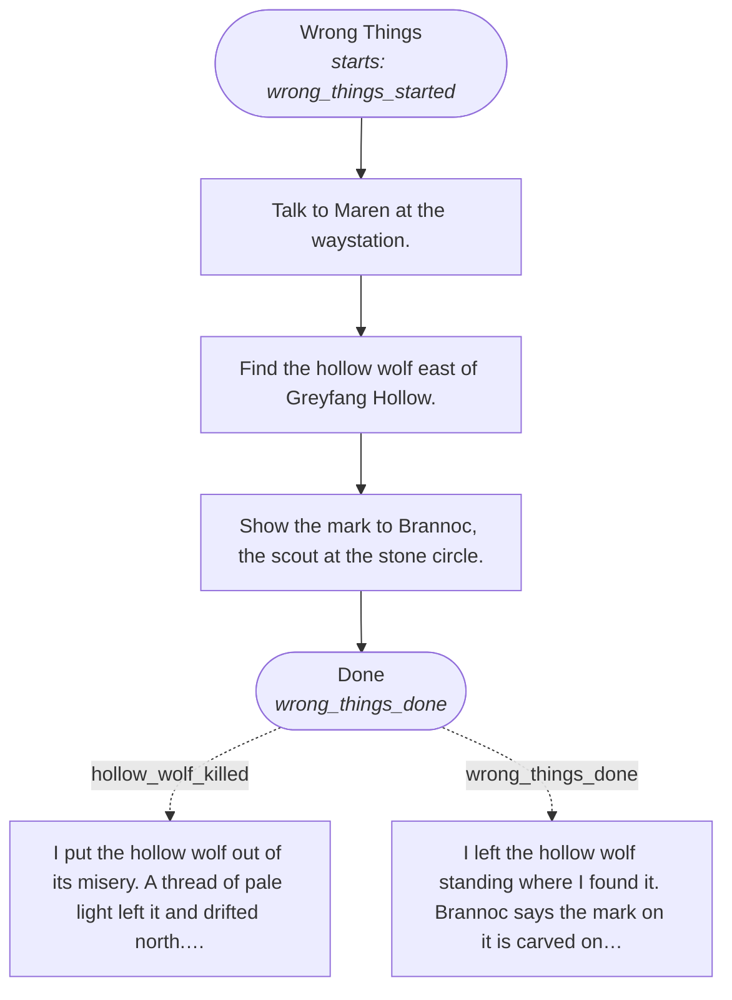

| Step | Done when | Marker |
|---|---|---|
| Talk to Maren at the waystation. | maren_wrong_things | Maren |
| Find the hollow wolf east of Greyfang Hollow. | saw_hollow_wolf | HollowWolf |
| Show the mark to Brannoc, the scout at the stone circle. | brannoc_saw_mark | Brannoc |

<a id="waking-stones"></a>

### The Waking Stones (`waking_stones`)

Given by: Brannoc, a scout of the Riverwatch garrison. Starts when: stones_quest_started. Done when: stones_quest_done, saw_drain_line.

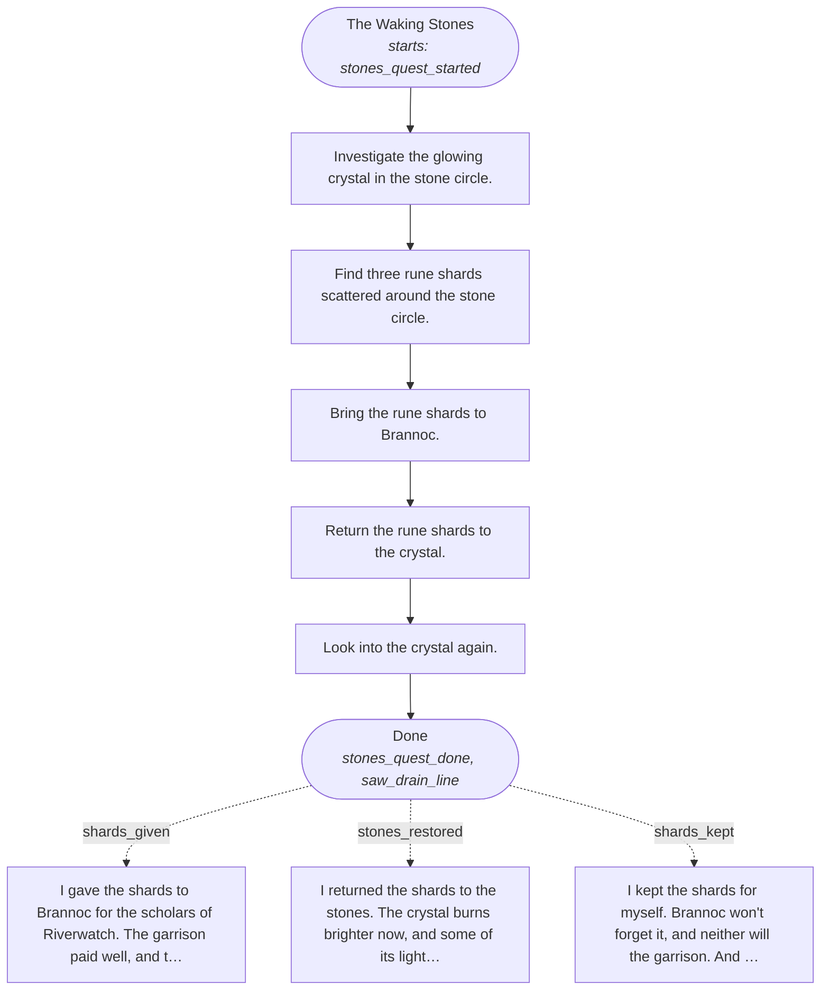

| Step | Done when | Marker |
|---|---|---|
| Investigate the glowing crystal in the stone circle. | touched_crystal | StoneCircle |
| Find three rune shards scattered around the stone circle. | has rune_shard x3 | ['RuneShard1', 'RuneShard2', 'RuneShard3'] |
| Bring the rune shards to Brannoc. | shards_decided | Brannoc |
| Return the rune shards to the crystal. | stones_restored | StoneCircle |
| Look into the crystal again. | saw_drain_line | StoneCircle |

<a id="ask-forest"></a>

### Ask the Forest (`ask_forest`)

Given by: The drain-line, running north from the stone circle. Starts when: saw_drain_line. Done when: barrow_lead.

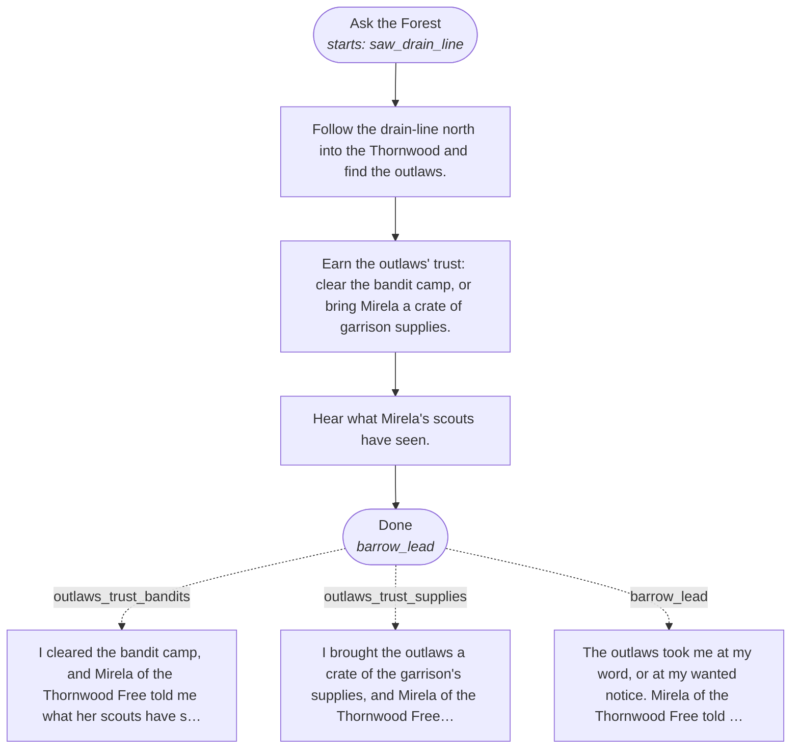

| Step | Done when | Marker |
|---|---|---|
| Follow the drain-line north into the Thornwood and find the outlaws. | met_mirela | Mirela |
| Earn the outlaws' trust: clear the bandit camp, or bring Mirela a crate of garrison supplies. | outlaws_trust | ['MapBanditCamp', 'Brannoc'] |
| Hear what Mirela's scouts have seen. | barrow_lead | Mirela |

<a id="the-barrow"></a>

### The Barrow (`the_barrow`)

Given by: Mirela of the Thornwood Free. Starts when: barrow_lead. Done when: wisp_choice_made.

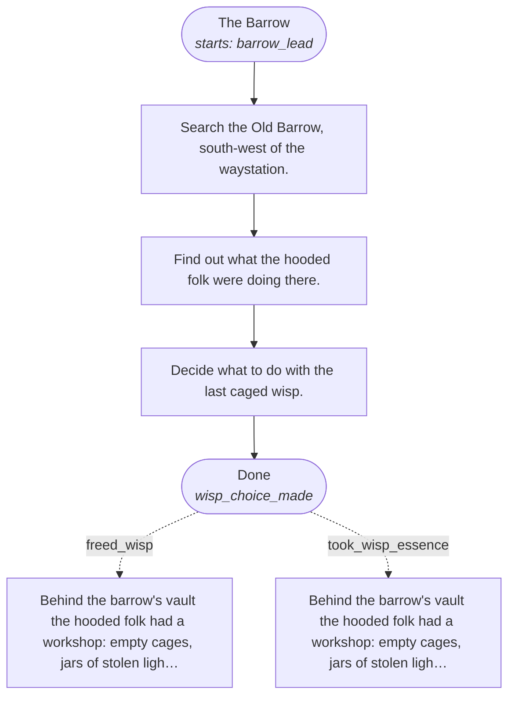

| Step | Done when | Marker |
|---|---|---|
| Search the Old Barrow, south-west of the waystation. | found_hidden_chamber | ['MapOldBarrow', 'SecretWall'] |
| Find out what the hooded folk were doing there. | has cult_notes | CultNotes |
| Decide what to do with the last caged wisp. | wisp_choice_made | CagedWisp |

<a id="what-they-made"></a>

### What They Made (`what_they_made`)

Given by: The cultist's notes. Starts when: taken:test_dungeon/CultNotes. Done when: demo_finished.

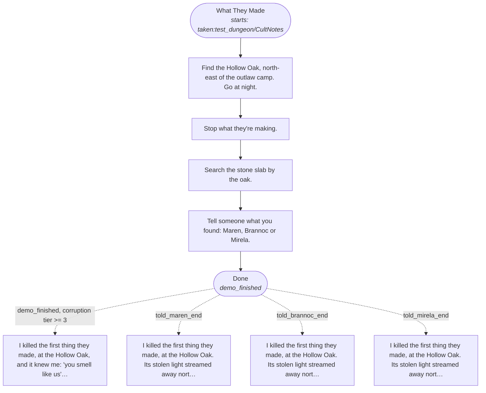

| Step | Done when | Marker |
|---|---|---|
| Find the Hollow Oak, north-east of the outlaw camp. Go at night. | ritual_started | HollowOak |
| Stop what they're making. | first_slain | TheFirst |
| Search the stone slab by the oak. | read_letter | RitualAltar |
| Tell someone what you found: Maren, Brannoc or Mirela. | demo_finished | ['Maren', 'Brannoc', 'Mirela'] |

<a id="down-the-greywater"></a>

### Down the Greywater (`down_the_greywater`)

Given by: Jory Vell, barge-hand on Weirholt's docks. Starts when: dark_barges_started. Done when: barges_resolved.

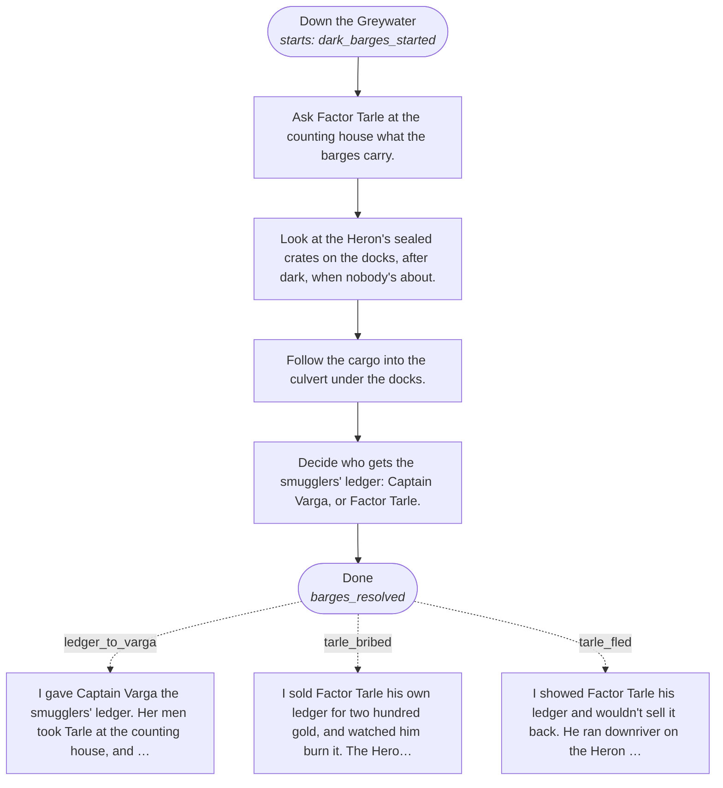

| Step | Done when | Marker |
|---|---|---|
| Ask Factor Tarle at the counting house what the barges carry. | asked_tarle_barges | Tarle |
| Look at the Heron's sealed crates on the docks, after dark, when nobody's about. | heron_inspected | HeronCrates |
| Follow the cargo into the culvert under the docks. | has harvest_ledger | CulvertGrate |
| Decide who gets the smugglers' ledger: Captain Varga, or Factor Tarle. | barges_resolved | Varga |

<a id="the-weirstones"></a>

### The Weirstones (`the_weirstones`)

Given by: The smugglers' ledger. Starts when: barges_resolved. Done when: weirstones_freed.

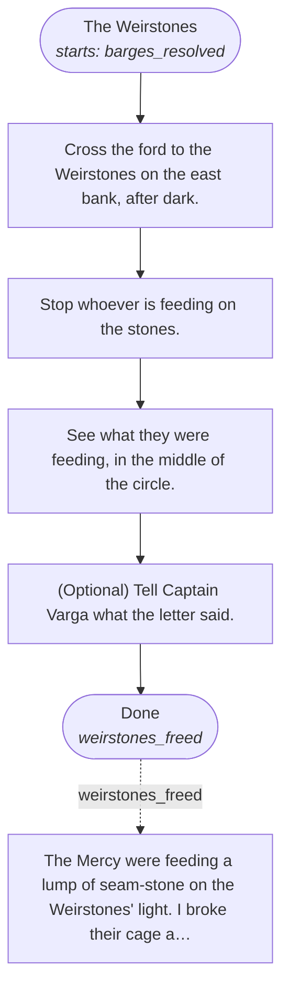

| Step | Done when | Marker |
|---|---|---|
| Cross the ford to the Weirstones on the east bank, after dark. | weirstones_rite | Weirstones |
| Stop whoever is feeding on the stones. | weirstones_cleared | Weirstones |
| See what they were feeding, in the middle of the circle. | weirstones_freed | DrainFocus |
| (Optional) Tell Captain Varga what the letter said. | weirstones_reported | Varga |

<a id="the-deep-ring"></a>

### The Deep Ring (`the_deep_ring`)

Given by: Listener Ysolde of Greyfold. Starts when: deep_ring_started. Done when: deep_ring_reported.

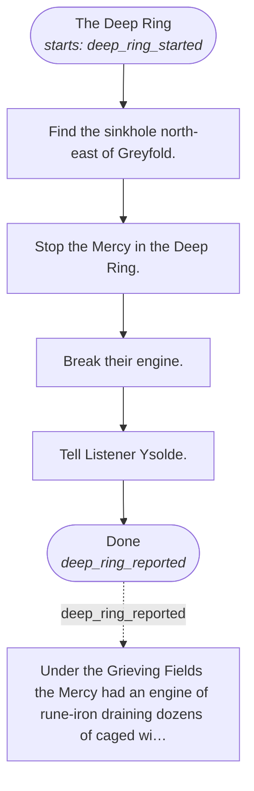

| Step | Done when | Marker |
|---|---|---|
| Find the sinkhole north-east of Greyfold. | discovered_sinkhole | Sinkhole |
| Stop the Mercy in the Deep Ring. | deep_ring_cleared | HarvestEngine |
| Break their engine. | harvest_engine_broken | HarvestEngine |
| Tell Listener Ysolde. | deep_ring_reported | Ysolde |

<a id="the-light-in-the-eaves"></a>

### The Light in the Eaves (`the_light_in_the_eaves`)

Given by: V.'s note, under the Grieving Fields. Starts when: vessa_note_read. Done when: light_reported.

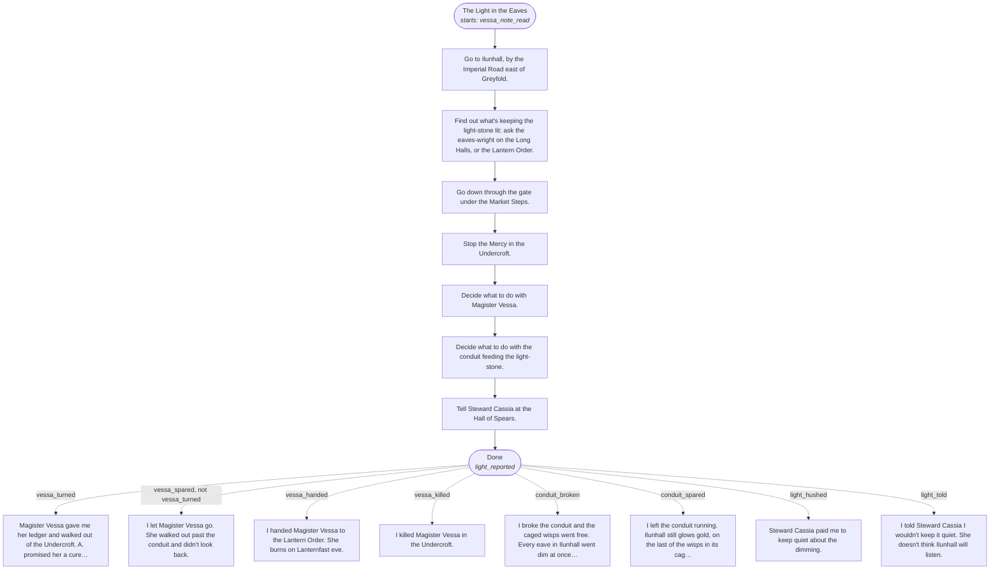

| Step | Done when | Marker |
|---|---|---|
| Go to Ilunhall, by the Imperial Road east of Greyfold. | discovered_ilunhall | ImperialRoad |
| Find out what's keeping the light-stone lit: ask the eaves-wright on the Long Halls, or the Lantern Order. | undercroft_lead | ['Karra', 'Severin'] |
| Go down through the gate under the Market Steps. | discovered_undercroft | UndercroftGate |
| Stop the Mercy in the Undercroft. | undercroft_cleared | Conduit |
| Decide what to do with Magister Vessa. | any of vessa_spared / vessa_handed / vessa_killed | ['Vessa', 'VessaFoe'] |
| Decide what to do with the conduit feeding the light-stone. | conduit_resolved | Conduit |
| Tell Steward Cassia at the Hall of Spears. | light_reported | Cassia |

## Side quests

<a id="greyfang"></a>

### The Greyfang Pack (`greyfang`)

Given by: Maren, keeper of the north road waystation. Starts when: wolf_quest_accepted. Done when: wolf_quest_done.

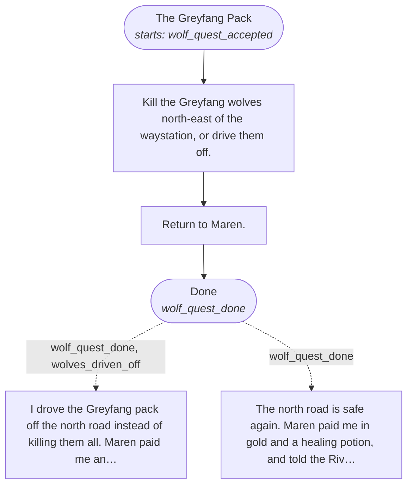

| Step | Done when | Marker |
|---|---|---|
| Kill the Greyfang wolves north-east of the waystation, or drive them off. | wolves_cleared | GreyfangPack |
| Return to Maren. | wolf_quest_done | Maren |

<a id="bandit-camp"></a>

### Thieves by the Fire (`bandit_camp`)

Given by: Brannoc, a scout of the Riverwatch garrison. Starts when: heard_about_bandits. Done when: bandit_bounty_paid.

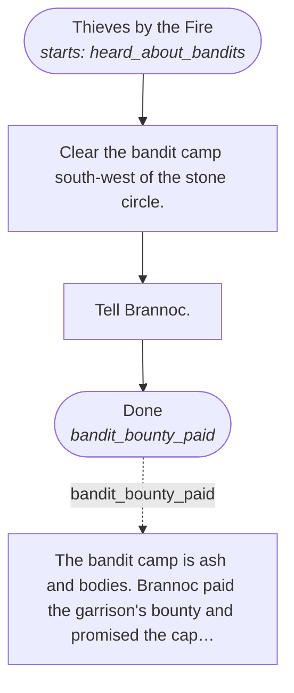

| Step | Done when | Marker |
|---|---|---|
| Clear the bandit camp south-west of the stone circle. | bandits_cleared | MapBanditCamp |
| Tell Brannoc. | bandit_bounty_paid | Brannoc |

<a id="silent-shrine"></a>

### Silent Shrine (`silent_shrine`)

Given by: The roadside shrine on the north road. Starts when: silent_shrine_started. Done when: shrine_answered.

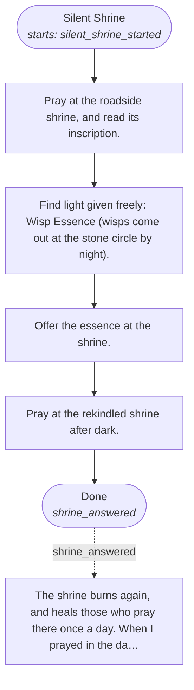

| Step | Done when | Marker |
|---|---|---|
| Pray at the roadside shrine, and read its inscription. | read_shrine_inscription | RoadsideShrine |
| Find light given freely: Wisp Essence (wisps come out at the stone circle by night). | has wisp_essence | MapStoneCircle |
| Offer the essence at the shrine. | shrine_rekindled | RoadsideShrine |
| Pray at the rekindled shrine after dark. | shrine_answered | RoadsideShrine |

<a id="lost-wagon"></a>

### The Lost Wagon (`lost_wagon`)

Given by: The north road. Starts when: lost_wagon_started. Done when: jory_settled.

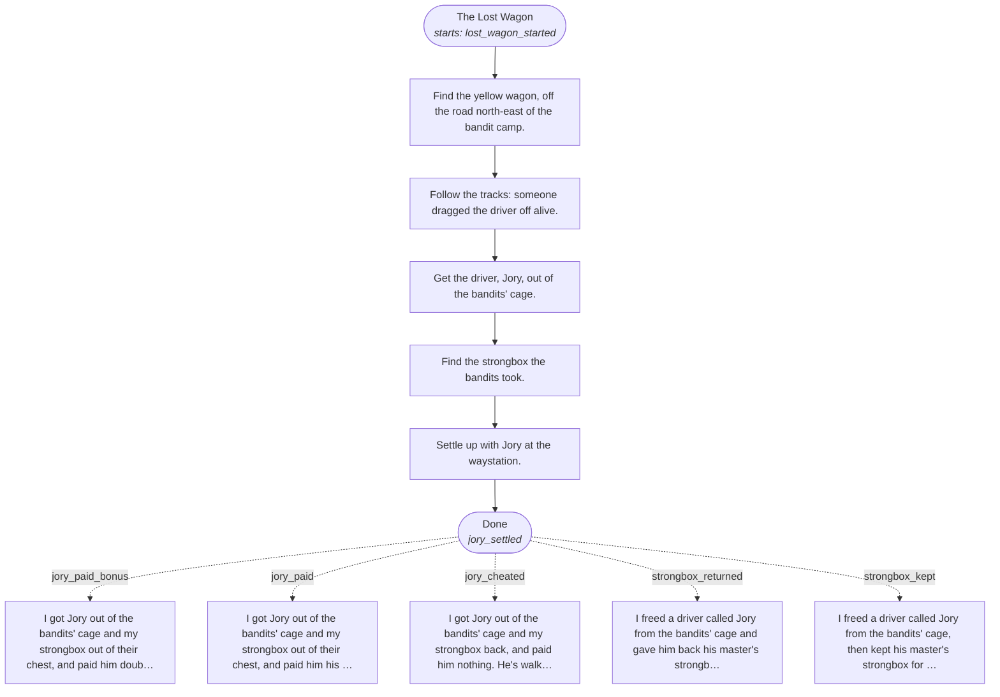

| Step | Done when | Marker |
|---|---|---|
| Find the yellow wagon, off the road north-east of the bandit camp. | found_wagon | LostWagon |
| Follow the tracks: someone dragged the driver off alive. | jory_found | JoryCaged |
| Get the driver, Jory, out of the bandits' cage. | jory_freed | JoryCaged |
| Find the strongbox the bandits took. | has strongbox | BanditChest |
| Settle up with Jory at the waystation. | jory_settled | JoryWaystation |

<a id="licence-to-burn"></a>

### Licence to Burn (`licence_to_burn`)

Given by: Brannoc, a scout of the Riverwatch garrison. Starts when: licence_started. Done when: brannoc_told_zora.

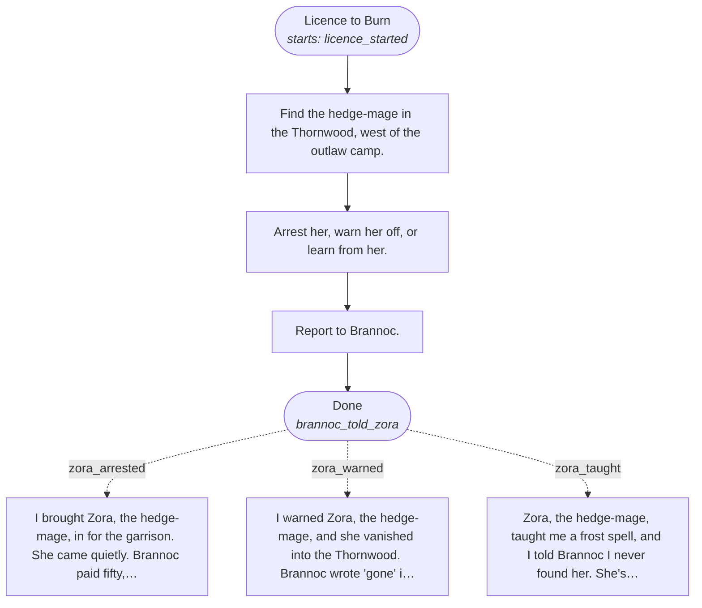

| Step | Done when | Marker |
|---|---|---|
| Find the hedge-mage in the Thornwood, west of the outlaw camp. | met_zora | Zora |
| Arrest her, warn her off, or learn from her. | zora_decided | Zora |
| Report to Brannoc. | brannoc_told_zora | Brannoc |

<a id="readings"></a>

### Readings Under the Wanderer (`readings`)

Given by: Magister Aurel of the Collegium, lodging at the waystation. Starts when: readings_started. Done when: readings_delivered.

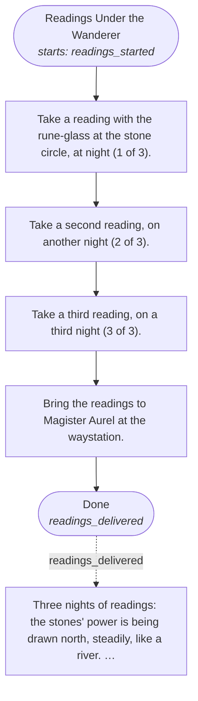

| Step | Done when | Marker |
|---|---|---|
| Take a reading with the rune-glass at the stone circle, at night (1 of 3). | readings_1 | ReadingStone |
| Take a second reading, on another night (2 of 3). | readings_2 | ReadingStone |
| Take a third reading, on a third night (3 of 3). | readings_3 | ReadingStone |
| Bring the readings to Magister Aurel at the waystation. | readings_delivered | Aurel |

<a id="the-merciful"></a>

### The Merciful (`the_merciful`)

Given by: Brannoc, a scout of the Riverwatch garrison, or the merciful themselves. Starts when: heard_about_mercy. Done when: mercy_cell_done.

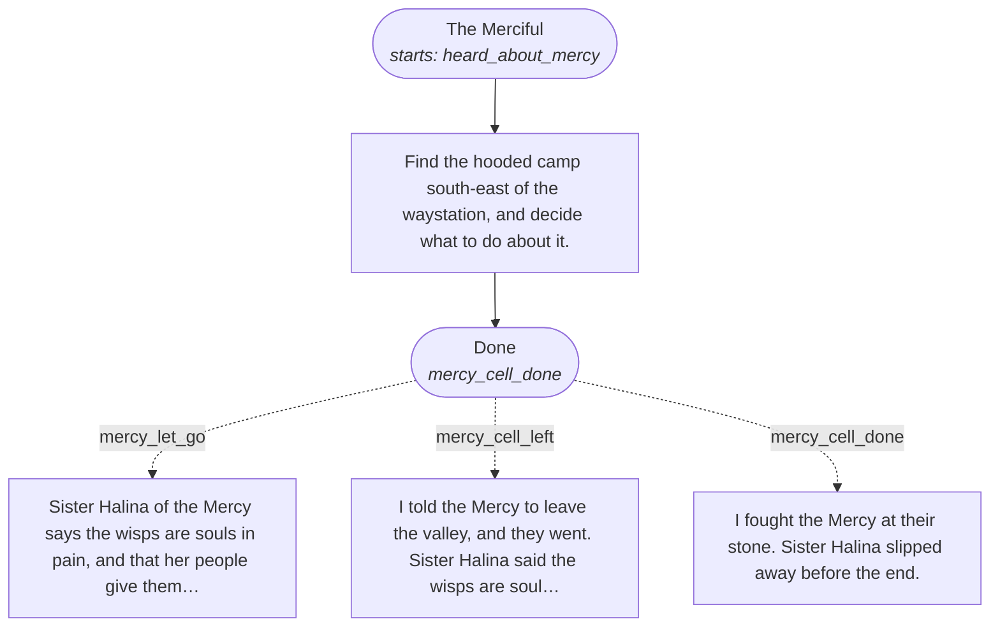

| Step | Done when | Marker |
|---|---|---|
| Find the hooded camp south-east of the waystation, and decide what to do about it. | mercy_cell_done | MercyCell |

<a id="brannoc-founded"></a>

### What Riverwatch Was Founded On (`brannoc_founded`)

Given by: Brannoc. Starts when: brannoc_founded_started. Done when: brannoc_founded_done.

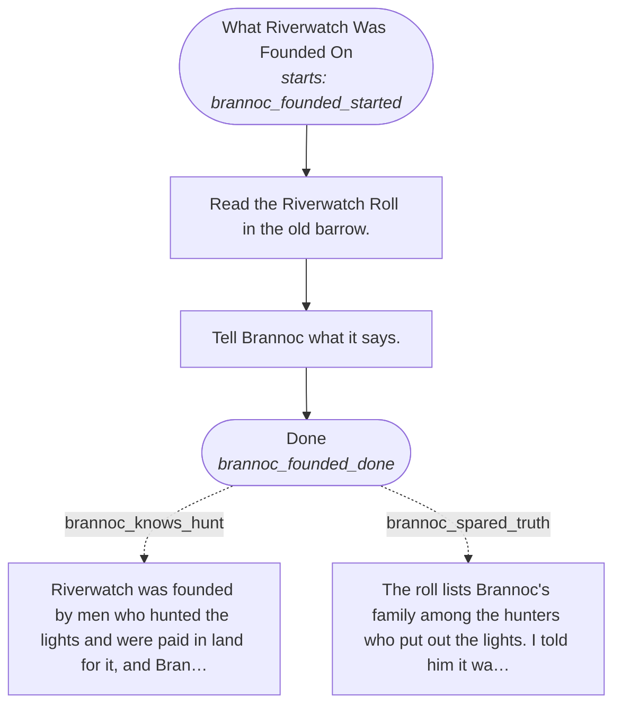

| Step | Done when | Marker |
|---|---|---|
| Read the Riverwatch Roll in the old barrow. | read_book_riverwatch_roll | DungeonEntrance |
| Tell Brannoc what it says. | brannoc_founded_done |  |

<a id="zora-notebook"></a>

### Her Teacher's Notebook (`zora_notebook`)

Given by: Zora. Starts when: zora_notebook_started. Done when: zora_notebook_done.

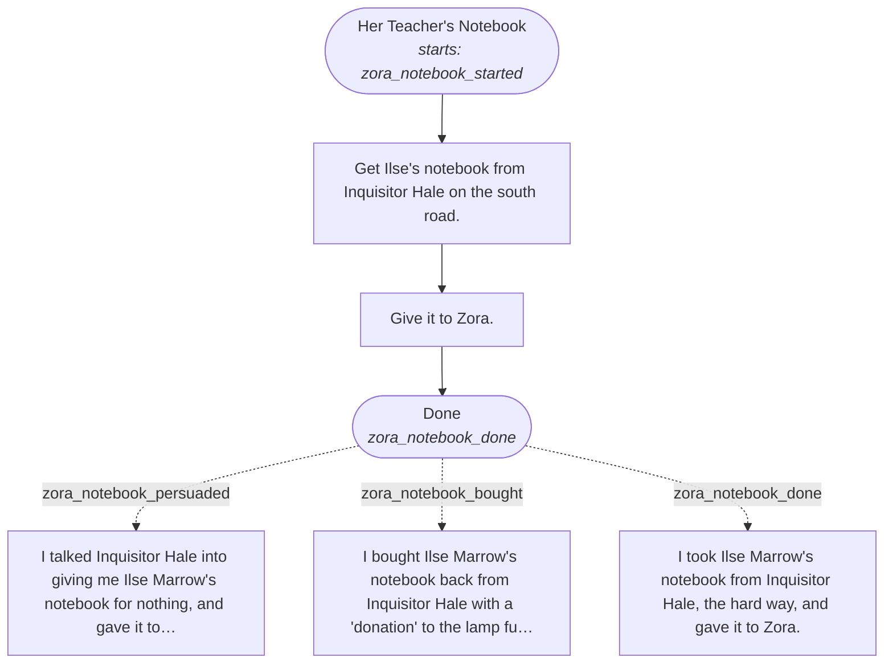

| Step | Done when | Marker |
|---|---|---|
| Get Ilse's notebook from Inquisitor Hale on the south road. | has book_ilse_notebook | Inquisitor |
| Give it to Zora. | zora_notebook_done |  |

<a id="toll-of-the-weir"></a>

### The Toll of the Weir (`toll_of_the_weir`)

Given by: Goodwife Ama, at Weirholt's south gate. Starts when: toll_started. Done when: ama_thanked.

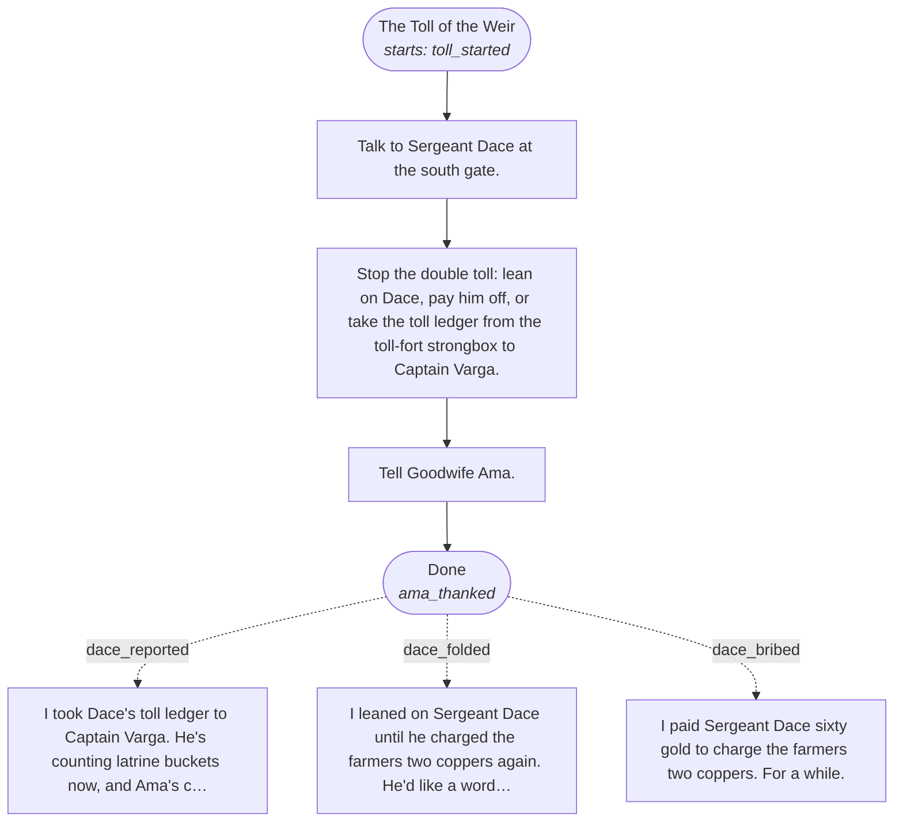

| Step | Done when | Marker |
|---|---|---|
| Talk to Sergeant Dace at the south gate. | toll_confronted | Dace |
| Stop the double toll: lean on Dace, pay him off, or take the toll ledger from the toll-fort strongbox to Captain Varga. | toll_settled | TollStrongbox |
| Tell Goodwife Ama. | ama_thanked | Ama |

<a id="lanes-fever"></a>

### Fever in the Lanes (`lanes_fever`)

Given by: Teodor, an elder of Weirholt's Passengers. Starts when: lanes_started. Done when: lanes_resolved.

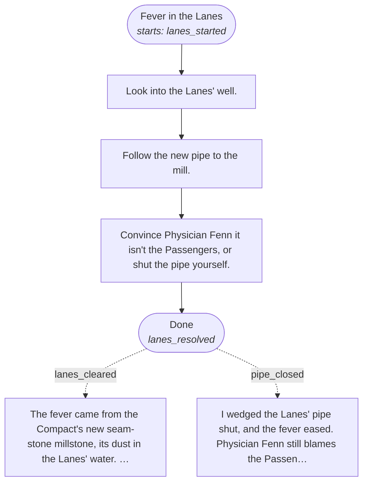

| Step | Done when | Marker |
|---|---|---|
| Look into the Lanes' well. | well_examined | LanesWell |
| Follow the new pipe to the mill. | millstone_found | Millstone |
| Convince Physician Fenn it isn't the Passengers, or shut the pipe yourself. | lanes_resolved | Fenn |

<a id="toll-road-gang"></a>

### The Toll-Road Gang (`toll_road_gang`)

Given by: Captain Varga, or an overturned cart on the north road. Starts when: bounty_started. Done when: bounty_paid.

```mermaid
flowchart TD
  start(["The Toll-Road Gang<br/><i>starts: bounty_started</i>"])
  o0["Find the gang's camp in the woods west of the north road."]
  start --> o0
  o1["Collect the bounty from Captain Varga."]
  o0 --> o1
  done(["Done<br/><i>bounty_paid</i>"])
  o1 --> done
  r0["I cleared out the gang in the woods and collected Captain Varga's hundred gold. The carter…"]
  done -. "bounty_paid" .-> r0
```

| Step | Done when | Marker |
|---|---|---|
| Find the gang's camp in the woods west of the north road. | toll_gang_cleared | TollRoadGang |
| Collect the bounty from Captain Varga. | bounty_paid | Varga |

<a id="the-wisp-finder"></a>

### The Wisp-Finder (`the_wisp_finder`)

Given by: Corin Dray, outside Greyfold. Starts when: corin_started. Done when: corin_resolved.

```mermaid
flowchart TD
  start(["The Wisp-Finder<br/><i>starts: corin_started</i>"])
  o0["Ask Corin who pays him."]
  start --> o0
  o1["Get him to stop: talk him round, pay him off, or tell Listener Ysolde."]
  o0 --> o1
  done(["Done<br/><i>corin_resolved</i>"])
  o1 --> done
  r0["I told Corin Dray where his lights were going. He quit, and went to tell Ysolde himself."]
  done -. "corin_quit" .-> r0
  r1["I paid Corin Dray a hundred gold to stop selling wisps to the Mercy."]
  done -. "corin_paid_off" .-> r1
  r2["I told Listener Ysolde that Corin Dray sells wisps to the Mercy. He left Greyfold that nig…"]
  done -. "corin_exiled" .-> r2
```

| Step | Done when | Marker |
|---|---|---|
| Ask Corin who pays him. | corin_confronted | Corin |
| Get him to stop: talk him round, pay him off, or tell Listener Ysolde. | corin_resolved | Corin |

<a id="cairns-of-the-rising"></a>

### Cairns of the Rising (`cairns_of_the_rising`)

Given by: Old Hesk, the cairn-keeper of Greyfold. Starts when: cairns_started. Done when: cairns_thanked.

```mermaid
flowchart TD
  start(["Cairns of the Rising<br/><i>starts: cairns_started</i>"])
  o0["Restack the three toppled cairns: west by the old ford, east past the laying grounds, south where the grass won't grow."]
  start --> o0
  o1["Tell Old Hesk."]
  o0 --> o1
  done(["Done<br/><i>cairns_thanked</i>"])
  o1 --> done
  r0["I restacked the three toppled cairns of the Rising. Old Hesk gave me his brother's sword."]
  done -. "cairns_thanked" .-> r0
```

| Step | Done when | Marker |
|---|---|---|
| Restack the three toppled cairns: west by the old ford, east past the laying grounds, south where the grass won't grow. | cairn_west, cairn_east, cairn_south | ['CairnWest', 'CairnEast', 'CairnSouth'] |
| Tell Old Hesk. | cairns_thanked | Hesk |

<a id="the-hundredth-horn"></a>

### The Hundredth Horn (`the_hundredth_horn`)

Given by: Nob Ashby, on Ilunhall's quay. Starts when: horn_started. Done when: any of horn_to_nob / horn_returned / horn_reported.

```mermaid
flowchart TD
  start(["The Hundredth Horn<br/><i>starts: horn_started</i>"])
  o0["Take the Hundredth Horn from the trophy chest in the Long Table (or tell Hallmaster Odo about Nob)."]
  start --> o0
  o1["Take the horn to Nob on the quay, or back to Hallmaster Odo."]
  o0 --> o1
  done(["Done<br/><i>any of horn_to_nob / horn_returned / horn_reported</i>"])
  o1 --> done
  r0["I stole the Hundredth Horn for Nob Ashby. If I want more work, I'm to knock twice at a win…"]
  done -. "horn_to_nob" .-> r0
  r1["I took the Hundredth Horn and gave it back to Hallmaster Odo, who found that very funny."]
  done -. "horn_returned" .-> r1
  r2["I told Hallmaster Odo, and the watch ran Nob Ashby off the quay."]
  done -. "horn_reported" .-> r2
```

| Step | Done when | Marker |
|---|---|---|
| Take the Hundredth Horn from the trophy chest in the Long Table (or tell Hallmaster Odo about Nob). | has hundredth_horn | ['TrophyChest', 'Odo'] |
| Take the horn to Nob on the quay, or back to Hallmaster Odo. | any of horn_to_nob / horn_returned | ['Nob', 'Odo'] |

<a id="a-verse-in-the-eaves"></a>

### A Verse in the Eaves (`a_verse_in_the_eaves`)

Given by: Saelie of the Low Lane, on Ilunhall's quay. Starts when: verse_started. Done when: verse_sung.

```mermaid
flowchart TD
  start(["A Verse in the Eaves<br/><i>starts: verse_started</i>"])
  o0["Read the three rune-stones on the Rune Bridge, at night when the runes are lit."]
  start --> o0
  o1["Bring the words to Saelie on the quay."]
  o0 --> o1
  done(["Done<br/><i>verse_sung</i>"])
  o1 --> done
  r0["Saelie sang me the third verse of Hallam and the Hundred Lights, the Choir's way: the lant…"]
  done -. "verse_sung" .-> r0
```

| Step | Done when | Marker |
|---|---|---|
| Read the three rune-stones on the Rune Bridge, at night when the runes are lit. | verse_rune_1, verse_rune_2, verse_rune_3 | ['RuneStone1', 'RuneStone2', 'RuneStone3'] |
| Bring the words to Saelie on the quay. | verse_sung | Saelie |

## Flag index

Every flag, where it's set, and where it's checked. **⚠ never set** means nothing in the game sets it: a typo or a missing step. *(never checked)* is usually fine: a record for later, or for the tests.

| Flag | Set by | Checked by |
|---|---|---|
| `ama_thanked` | ama: after | ama (start → after)<br>ama (start → thanked)<br>quest toll_of_the_weir |
| `asked_tarle_barges` | tarle: barges_lie | quest down_the_greywater<br>tarle: again, "What do the barges carry at the dark ..."<br>tarle: greet, "What do the barges carry at the dark ..." |
| `aurel_saw_stain` | aurel: sees_stain | aurel (start → sees_stain) |
| `bandit_bounty_paid` | brannoc: bandit_bounty | brannoc: after_given, "The bandit camp south-west of here is..."<br>brannoc: after_kept, "The bandit camp south-west of here is..."<br>brannoc: after_restored, "The bandit camp south-west of here is..."<br>brannoc: greet, "The bandit camp south-west of here is..."<br>brannoc: greet_again, "The bandit camp south-west of here is..."<br>brannoc: progress, "The bandit camp south-west of here is..."<br>brannoc: waiting_on_stones, "The bandit camp south-west of here is..."<br>quest bandit_camp |
| `bandit_cage_opened` | levels/test_level.tscn (CageDoor) | jory_caged (start → freed) |
| `bandits_cleared` | levels/test_level.tscn (BanditCamp) | brannoc: after_given, "Anything else I should know about out..."<br>brannoc: after_given, "The bandit camp south-west of here is..."<br>brannoc: after_kept, "The bandit camp south-west of here is..."<br>brannoc: after_restored, "Anything else I should know about out..."<br>brannoc: after_restored, "The bandit camp south-west of here is..."<br>brannoc: greet, "Anything else I should know about out..."<br>brannoc: greet, "The bandit camp south-west of here is..."<br>brannoc: greet_again, "Anything else I should know about out..."<br>brannoc: greet_again, "The bandit camp south-west of here is..."<br>brannoc: progress, "Anything else I should know about out..."<br>brannoc: progress, "The bandit camp south-west of here is..."<br>brannoc: waiting_on_stones, "Anything else I should know about out..."<br>brannoc: waiting_on_stones, "The bandit camp south-west of here is..."<br>mirela (start → bandits_done)<br>mirela: terms, "I'll deal with the bandits."<br>mirela: terms, "That camp's already ash."<br>quest bandit_camp |
| `barges_resolved` | tarle: ledger, "Deal."<br>tarle: ledger, "No. Captain Varga gets this."<br>varga: ledger | jory_weirholt (start → after)<br>quest down_the_greywater<br>quest the_weirstones<br>tarle: again, "I found your ledger in the culvert."<br>tarle: greet, "I found your ledger in the culvert."<br>varga: again, "I have something you should see."<br>varga: again, "Where does the ledger's trail go?"<br>varga: greet, "I have something you should see."<br>varga: greet, "Where does the ledger's trail go?" |
| `barrow_lead` | mirela: lead | mirela (start → after_lead)<br>quest ask_forest<br>quest the_barrow |
| `bought_tome_crush` | aurel: sold_crush | aurel: teach, "Moon-Crush. (220 gold)"<br>aurel: teach, "The Lifting Tide. (400 gold)"<br>aurel: teach, "The Lifting Tide?" |
| `bought_tome_lift` | aurel: sold_lift | aurel: teach, "The Lifting Tide. (400 gold)" |
| `bought_tome_pull` | aurel: sold_pull | aurel: teach, "Pull. (80 gold)" |
| `bought_tome_shove` | aurel: sold_shove | aurel: teach, "Tide's Shove. (100 gold)" |
| `bought_tome_well` | aurel: sold_well | aurel: teach, "Gravity Well. (160 gold)"<br>aurel: teach, "Moon-Crush. (220 gold)"<br>aurel: teach, "Moon-Crush?" |
| `bounty_accepted` | varga: bounty | varga: again, "Somebody's robbing carts on the north..."<br>varga: greet, "Somebody's robbing carts on the north..." |
| `bounty_paid` | varga: bounty_paid | quest toll_road_gang<br>varga: again, "The camp in the woods is cleared."<br>varga: greet, "The camp in the woods is cleared." |
| `bounty_started` | varga: bounty<br>weirholt_cart: look | quest toll_road_gang |
| `brannoc_founded_done` | companion_brannoc: roll_lie<br>companion_brannoc: roll_truth | companion_brannoc: cold, "I read the roll in the barrow."<br>companion_brannoc: greet, "I read the roll in the barrow."<br>companion_brannoc: warm, "I read the roll in the barrow."<br>quest brannoc_founded |
| `brannoc_founded_started` | companion_brannoc: founded | companion_brannoc: cold, "I read the roll in the barrow."<br>companion_brannoc: cold, "Your father's story, about who founde..."<br>companion_brannoc: greet, "I read the roll in the barrow."<br>companion_brannoc: greet, "Your father's story, about who founde..."<br>companion_brannoc: warm, "I read the roll in the barrow."<br>companion_brannoc: warm, "Your father's story, about who founde..."<br>quest brannoc_founded |
| `brannoc_knows_hunt` | companion_brannoc: roll_truth | quest brannoc_founded |
| `brannoc_saw_mark` | brannoc: mark | brannoc (start → mark)<br>quest wrong_things |
| `brannoc_spared_truth` | companion_brannoc: roll_lie | quest brannoc_founded |
| `brannoc_told_zora` | brannoc: zora_gone<br>brannoc: zora_paid | brannoc (start → zora_report)<br>quest licence_to_burn |
| `brannoc_would_travel` | brannoc: after_all | brannoc: after_given, "Come with me. Now, not later."<br>brannoc: after_given, "What will you do, after all this?"<br>brannoc: after_kept, "Come with me. Now, not later."<br>brannoc: after_kept, "What will you do, after all this?"<br>brannoc: after_restored, "Come with me. Now, not later."<br>brannoc: after_restored, "What will you do, after all this?"<br>brannoc: greet_again, "Come with me. Now, not later."<br>brannoc: greet_again, "What will you do, after all this?"<br>brannoc: progress, "Come with me. Now, not later."<br>brannoc: progress, "What will you do, after all this?"<br>brannoc: waiting_on_stones, "Come with me. Now, not later."<br>brannoc: waiting_on_stones, "What will you do, after all this?" |
| `cairn_east` | fields_cairn_east: look, "Stack it again, stone by stone." | fields_cairn_east (start → done)<br>hesk (start → report)<br>quest cairns_of_the_rising |
| `cairn_south` | fields_cairn_south: look, "Stack it again, stone by stone." | fields_cairn_south (start → done)<br>hesk (start → report)<br>quest cairns_of_the_rising |
| `cairn_west` | fields_cairn_west: look, "Stack it again, stone by stone." | fields_cairn_west (start → done)<br>hesk (start → report)<br>quest cairns_of_the_rising |
| `cairns_started` | hesk: where | hesk (start → waiting)<br>quest cairns_of_the_rising |
| `cairns_thanked` | hesk: report | hesk (start → done)<br>quest cairns_of_the_rising |
| `choir_verse_ilunhall` (never checked) | saelie: ready | – |
| `companion_brannoc` | brannoc: join | brannoc: after_given, "Come with me. Now, not later."<br>brannoc: after_kept, "Come with me. Now, not later."<br>brannoc: after_restored, "Come with me. Now, not later."<br>brannoc: greet_again, "Come with me. Now, not later."<br>brannoc: progress, "Come with me. Now, not later."<br>brannoc: waiting_on_stones, "Come with me. Now, not later."<br>levels/test_level.tscn (BrannocAtPost)<br>zora: again, "Come with me."<br>zora: taught, "Come with me." |
| `companion_cmd_dismiss` (never checked) | companion_brannoc: home<br>companion_zora: home | – |
| `companion_cmd_follow` (never checked) | companion_brannoc: follow<br>companion_zora: follow | – |
| `companion_cmd_talk` (never checked) | companion_brannoc: cold, "About something else."<br>companion_brannoc: greet, "About something else."<br>companion_brannoc: warm, "About something else."<br>companion_zora: cold, "About something else."<br>companion_zora: greet, "About something else."<br>companion_zora: warm, "About something else." | – |
| `companion_cmd_wait` (never checked) | companion_brannoc: wait<br>companion_zora: wait | – |
| `companion_zora` | zora: join | brannoc: after_given, "Come with me. Now, not later."<br>brannoc: after_kept, "Come with me. Now, not later."<br>brannoc: after_restored, "Come with me. Now, not later."<br>brannoc: greet_again, "Come with me. Now, not later."<br>brannoc: progress, "Come with me. Now, not later."<br>brannoc: waiting_on_stones, "Come with me. Now, not later."<br>levels/test_level.tscn (ZoraAtHome)<br>zora: again, "Come with me."<br>zora: taught, "Come with me." |
| `conduit_broken` | ilunhall_conduit: look, "Break it. Let them go." | cassia: report, "The light-stone was being fed. Draine..."<br>ilunhall_hall_doors (start → dim)<br>karra (start → after)<br>levels/ilunhall.tscn (ChapterhouseLightStone)<br>levels/ilunhall.tscn (EmberCollegeLightStone)<br>levels/ilunhall.tscn (HallOfSpearsLightStone)<br>levels/ilunhall.tscn (LongTableLightStone)<br>levels/ilunhall_undercroft.tscn (Veins)<br>quest the_light_in_the_eaves |
| `conduit_resolved` | ilunhall_conduit: look, "Break it. Let them go."<br>ilunhall_conduit: look, "Leave it running. The city needs its ..." | cassia (start → report)<br>ilunhall_conduit (start → done)<br>quest the_light_in_the_eaves |
| `conduit_spared` | ilunhall_conduit: look, "Leave it running. The city needs its ..." | cassia: report, "The Mercy were feeding the light-ston..."<br>quest the_light_in_the_eaves |
| `corin_confronted` | corin: who | corin: again, "About your buyers."<br>corin: again, "Who pays you?"<br>quest the_wisp_finder<br>ysolde: again, "Corin Dray sells wisps to the Mercy."<br>ysolde: greet, "Corin Dray sells wisps to the Mercy." |
| `corin_exiled` | ysolde: corin_exile | quest the_wisp_finder |
| `corin_paid_off` | corin: options, "Here: a hundred gold. That's more tha..." | quest the_wisp_finder |
| `corin_quit` | corin: options, "They're draining them under the field..." | quest the_wisp_finder |
| `corin_resolved` | corin: options, "Here: a hundred gold. That's more tha..."<br>corin: options, "They're draining them under the field..."<br>ysolde: corin_exile | corin (start → resolved)<br>quest the_wisp_finder<br>ysolde: again, "Corin Dray sells wisps to the Mercy."<br>ysolde: greet, "Corin Dray sells wisps to the Mercy." |
| `corin_started` | corin: greet | corin (start → again)<br>quest the_wisp_finder |
| `cultists_cleared` (never checked) | levels/test_dungeon.tscn (Cultists) | – |
| `culvert_cleared` (never checked) | levels/weirholt_culvert.tscn (Smugglers) | – |
| `culvert_wisp_freed` | weirholt_cages: look, "Open the cage." | weirholt_cages (start → empty) |
| `dace_bribed` | dace: dace_two, "Here. Take this, and charge the farme..." | quest toll_of_the_weir |
| `dace_folded` | dace: dace_two, "Rates went up when you got greedy. St..." | quest toll_of_the_weir |
| `dace_reported` | varga: dace_report | quest toll_of_the_weir |
| `dark_barges_started` | jory_weirholt: barges, "I'll look into it." | jory_weirholt: again, "Not yet."<br>jory_weirholt: again, "Tell me about the barges again."<br>quest down_the_greywater<br>tarle: again, "What do the barges carry at the dark ..."<br>tarle: greet, "What do the barges carry at the dark ..." |
| `deep_ring_cleared` | levels/grieving_deep_ring.tscn (Mercy) | deep_ring_engine (start → open)<br>quest the_deep_ring |
| `deep_ring_reported` | ysolde: report | quest the_deep_ring<br>ysolde: again, "The Deep Ring is broken. The lights a..."<br>ysolde: greet, "The Deep Ring is broken. The lights a..." |
| `deep_ring_started` | ysolde: screaming | quest the_deep_ring<br>ysolde: again, "What's wrong here?"<br>ysolde: elf, "What's wrong here?"<br>ysolde: greet, "What's wrong here?"<br>ysolde: kin, "What's wrong here?" |
| `deep_ring_wisps_freed` (never checked) | deep_ring_engine: open, "Smash the rune-iron and let them go." | – |
| `demo_finished` | brannoc: end_brannoc<br>brannoc: end_hollow<br>maren: end_hollow<br>maren: end_maren<br>mirela: end_hollow<br>mirela: end_mirela<br>mirela: end_mirela_cold | brannoc (start → end_hollow)<br>brannoc (start → end_intro)<br>maren (start → end_hollow)<br>maren (start → end_intro)<br>mirela (start → end_hollow)<br>mirela (start → end_intro)<br>quest what_they_made |
| `discovered_ama_farm` (never checked) | levels/weirholt.tscn (MapFarm, when found) | – |
| `discovered_bandit_camp` (never checked) | levels/test_level.tscn (MapBanditCamp, when found) | – |
| `discovered_chapterhouse` (never checked) | levels/ilunhall.tscn (MapChapterhouse, when found) | – |
| `discovered_corin_hut` (never checked) | levels/grieving_fields.tscn (MapCorinHut, when found) | – |
| `discovered_counting_house` (never checked) | levels/weirholt.tscn (MapCountingHouse, when found) | – |
| `discovered_ember_college` (never checked) | levels/ilunhall.tscn (MapEmberCollege, when found) | – |
| `discovered_greyfang_hollow` (never checked) | levels/test_level.tscn (MapGreyfangHollow, when found) | – |
| `discovered_greyfold` (never checked) | levels/grieving_fields.tscn (MapGreyfold, when found) | – |
| `discovered_hall_of_spears` (never checked) | levels/ilunhall.tscn (MapHallOfSpears, when found) | – |
| `discovered_hollow_oak` (never checked) | levels/test_level.tscn (MapHollowOak, when found) | – |
| `discovered_ilunhall` | levels/ilunhall.tscn (MapIlunhall, when found) | quest the_light_in_the_eaves |
| `discovered_lantern_weir` (never checked) | levels/weirholt.tscn (MapInn, when found) | – |
| `discovered_laying_grounds` (never checked) | levels/grieving_fields.tscn (MapLayingGrounds, when found) | – |
| `discovered_long_table` (never checked) | levels/ilunhall.tscn (MapLongTable, when found) | – |
| `discovered_old_barrow` (never checked) | levels/test_level.tscn (MapOldBarrow, when found) | – |
| `discovered_outlaw_camp` (never checked) | levels/test_level.tscn (MapOutlawCamp, when found) | – |
| `discovered_roadside_shrine` (never checked) | levels/test_level.tscn (MapShrine, when found) | – |
| `discovered_rune_bridge` (never checked) | levels/ilunhall.tscn (MapRuneBridge, when found) | – |
| `discovered_sinkhole` | levels/grieving_fields.tscn (MapSinkhole, when found) | quest the_deep_ring |
| `discovered_south_road` (never checked) | levels/test_level.tscn (MapSouthRoad, when found) | – |
| `discovered_stone_circle` (never checked) | levels/test_level.tscn (MapStoneCircle, when found) | – |
| `discovered_the_lanes` (never checked) | levels/weirholt.tscn (MapLanes, when found) | – |
| `discovered_toll_fort` (never checked) | levels/weirholt.tscn (MapTollFort, when found) | – |
| `discovered_toll_road_camp` (never checked) | levels/weirholt.tscn (MapGangCamp, when found) | – |
| `discovered_undercroft` | levels/ilunhall_undercroft.tscn (MapUndercroft, when found) | quest the_light_in_the_eaves |
| `discovered_waystation` (never checked) | levels/test_level.tscn (MapWaystation, when found) | – |
| `discovered_weirholt` (never checked) | levels/weirholt.tscn (MapWeirholt, when found) | – |
| `discovered_weirholt_docks` (never checked) | levels/weirholt.tscn (MapDocks, when found) | – |
| `discovered_weirholt_ford` (never checked) | levels/weirholt.tscn (MapFord, when found) | – |
| `discovered_weirholt_mill` (never checked) | levels/weirholt.tscn (MapMill, when found) | – |
| `discovered_weirstones` (never checked) | levels/weirholt.tscn (MapWeirstones, when found) | – |
| `feast_bed` | odo: bed, "Here's ten." | levels/ilunhall.tscn (FeastBed)<br>odo: feast, "I need a bed."<br>odo: greet, "I need a bed."<br>odo: greet_again, "I need a bed." |
| `first_recognised_you` (never checked) | enemies/the_first.gd:50 | – |
| `first_slain` | enemies/the_first.gd:14 | levels/test_level.tscn (FirstStream)<br>props/ritual_altar.gd:7<br>props/ritual_site.gd:17<br>quest what_they_made |
| `found_hidden_chamber` | props/puzzle/secret_wall.gd:7 | levels/test_dungeon.tscn (Cultist1)<br>levels/test_dungeon.tscn (Cultist2)<br>quest the_barrow |
| `found_wagon` | wagon: look<br>wagon: merchant | quest lost_wagon<br>wagon (start → again) |
| `freed_wisp` | caged_wisp: free | maren: end_letter, "It followed me out of the barrow. The..."<br>mirela (start → heard_freed)<br>quest the_barrow |
| `got_lantern_cake` | lf_hettie: greet | lf_hettie (start → again) |
| `got_riverwatch_gift` | brannoc: gift | brannoc (start → gift) |
| `got_supply_crate` | brannoc: crate | brannoc: after_given, "I need a crate of the garrison's supp..."<br>brannoc: after_restored, "I need a crate of the garrison's supp..."<br>brannoc: greet, "I need a crate of the garrison's supp..."<br>brannoc: greet_again, "I need a crate of the garrison's supp..."<br>brannoc: progress, "I need a crate of the garrison's supp..."<br>brannoc: waiting_on_stones, "I need a crate of the garrison's supp..." |
| `halina_taught_draw` | halina: teach_draw | halina: again, "Teach me the rest."<br>halina: again, "Teach me to do what you do."<br>halina: same, "Teach me the rest."<br>halina: same, "Teach me to do what you do." |
| `halina_taught_touch` | halina: teach_touch | halina: again, "Teach me the rest."<br>halina: same, "Teach me the rest." |
| `harvest_engine_broken` | deep_ring_engine: open, "Smash the rune-iron and let them go." | deep_ring_engine (start → done)<br>quest the_deep_ring<br>ysolde: again, "The Deep Ring is broken. The lights a..."<br>ysolde: greet, "The Deep Ring is broken. The lights a..." |
| `heard_about_bandits` | brannoc: bandits_info | brannoc: after_given, "Anything else I should know about out..."<br>brannoc: after_restored, "Anything else I should know about out..."<br>brannoc: greet, "Anything else I should know about out..."<br>brannoc: greet_again, "Anything else I should know about out..."<br>brannoc: progress, "Anything else I should know about out..."<br>brannoc: waiting_on_stones, "Anything else I should know about out..."<br>quest bandit_camp |
| `heard_about_mercy` | brannoc: bandits_info<br>halina: greet | quest the_merciful |
| `heard_about_wolves` | maren: wolves | maren: greet_again, "I'll deal with the Greyfang pack." |
| `heard_card_player` | maren: road_folk | maren: greet_again, "Who else comes up this road?" |
| `heard_greyfang_reason` (never checked) | maren: wolves_why | – |
| `heard_hallam` (never checked) | ostap: song | – |
| `heard_hallam_sung` (never checked) | props/lanternfast_song.gd:38 | – |
| `heard_of_thornwood` (never checked) | brannoc: mark_hunter | – |
| `heron_inspected` | weirholt_heron: night | quest down_the_greywater<br>weirholt_heron (start → done) |
| `hint_climb` | Hints.show_once(id) sets hint_<id> (systems/hints.gd) | player/player_traversal.gd:44 |
| `hollow_wolf_killed` | enemies/hollow_wolf.gd:66<br>hollow_wolf: mercy | enemies/hollow_wolf.gd:31<br>quest wrong_things |
| `hollow_wolf_spared` (never checked) | hollow_wolf: leave | – |
| `horn_reported` | odo: report | levels/ilunhall.tscn (NobHere)<br>odo: greet, "Nob Ashby on the quay wants your Hund..."<br>odo: greet_again, "Nob Ashby on the quay wants your Hund..."<br>quest the_hundredth_horn |
| `horn_returned` | odo: return | nob (start → returned)<br>odo: greet, "Nob Ashby on the quay wants your Hund..."<br>odo: greet_again, "Nob Ashby on the quay wants your Hund..."<br>quest the_hundredth_horn |
| `horn_started` | nob: job, "I'll get it."<br>nob: job, "Not my line of work." | nob (start → again)<br>odo: greet, "Nob Ashby on the quay wants your Hund..."<br>odo: greet_again, "Nob Ashby on the quay wants your Hund..."<br>quest the_hundredth_horn |
| `horn_to_nob` | nob: have, "Here. A hundred and fifty, you said." | nob (start → paid)<br>odo: greet, "Nob Ashby on the quay wants your Hund..."<br>odo: greet_again, "Nob Ashby on the quay wants your Hund..."<br>quest the_hundredth_horn |
| `hunter_read_tracks` | hollow_wolf: tracks | brannoc: drain_line, "(Hunter) Same way the hollow wolf's t..."<br>brannoc: mark, "(Hunter) Its tracks came out of the f..." |
| `inn_room` | hedda: bed, "Here." | hedda: again, "I need a bed."<br>hedda: greet, "I need a bed."<br>levels/weirholt.tscn (InnRoom) |
| `inquisitor_hostile` | inquisitor: draws<br>inquisitor: marked (walking away)<br>inquisitor: marked, "(Fight.)"<br>inquisitor: notebook_draw | inquisitor (start → spared_again)<br>levels/test_level.tscn (InquisitorDrawn)<br>levels/test_level.tscn (InquisitorOnRoad) |
| `inquisitor_spared` | inquisitor: spared<br>inquisitor: spared_afraid<br>inquisitor: spared_bribed | inquisitor (start → spared_again) |
| `inquisitor_told_zora` | inquisitor: told | zora (start → betrayed)<br>zora (start → lanternfast)<br>zora: again, "Come with me."<br>zora: again, "Teach me more of it."<br>zora: again, "What do you really do? Not the fire."<br>zora: again, "Would you ever leave this place?"<br>zora: taught, "Come with me."<br>zora: taught, "Teach me more of it."<br>zora: taught, "What do you really do? Not the fire."<br>zora: taught, "Would you ever leave this place?" |
| `inquisitor_warned` | inquisitor: suspicious | inquisitor (start → suspicious) |
| `jory_cheated` | jory: merchant_cheat | quest lost_wagon |
| `jory_found` | jory_caged: freed<br>jory_caged: locked | quest lost_wagon |
| `jory_freed` | jory_caged: freed | levels/test_level.tscn (JoryAtWaystation)<br>levels/test_level.tscn (JoryInCage)<br>quest lost_wagon |
| `jory_paid` | jory: merchant_wages | quest lost_wagon |
| `jory_paid_bonus` | jory: merchant_bonus | quest lost_wagon |
| `jory_settled` | jory: keep_box<br>jory: merchant_bonus<br>jory: merchant_cheat<br>jory: merchant_wages<br>jory: return_box | jory (start → settled)<br>jory_weirholt (start → greet_known)<br>quest lost_wagon |
| `kept_vigil` (never checked) | props/shrine.gd:66 | – |
| `knows_marked_coin` (never checked) | mirela: coin | – |
| `lampless_friend` (never checked) | nob: have, "Here. A hundred and fifty, you said." | – |
| `lanes_cleared` | fenn: proof, "(Alchemy) The sheen, the metal taste,..."<br>fenn: proof, "Come and look at the well with me. If..." | quest lanes_fever |
| `lanes_resolved` | fenn: proof, "(Alchemy) The sheen, the metal taste,..."<br>fenn: proof, "Come and look at the well with me. If..."<br>weirholt_millstone: known, "Wedge the Lanes' pipe shut." | fenn: greet, "It isn't the Passengers. It's the new..."<br>fenn: greet, "Why blame the Lanes?"<br>quest lanes_fever<br>teodor (start → after)<br>weirholt_millstone: known, "Wedge the Lanes' pipe shut." |
| `lanes_started` | teodor: ask | quest lanes_fever<br>teodor (start → again) |
| `lanternfast_maren` | maren: lanternfast | maren (start → lanternfast) |
| `lanternfast_now` | systems/lanternfast.gd:21 | enemies/wisp.gd:237<br>levels/test_level.tscn (Lanternfast)<br>maren (start → lanternfast)<br>ostap (start → lanternfast)<br>systems/lanternfast.gd:17<br>zora (start → lanternfast) |
| `lanternfast_ostap` | ostap: lanternfast | ostap (start → lanternfast) |
| `lanternfast_zora` | zora: lanternfast | zora (start → lanternfast) |
| `ledger_to_varga` | varga: ledger | quest down_the_greywater |
| `ledger_to_varga_late` (never checked) | varga: ledger_late | – |
| `left_you_brannoc` | systems/companions.gd sets left_you_<id> when a companion walks out | brannoc: after_given, "Come with me. Now, not later."<br>brannoc: after_kept, "Come with me. Now, not later."<br>brannoc: after_restored, "Come with me. Now, not later."<br>brannoc: greet_again, "Come with me. Now, not later."<br>brannoc: progress, "Come with me. Now, not later."<br>brannoc: waiting_on_stones, "Come with me. Now, not later." |
| `left_you_zora` | systems/companions.gd sets left_you_<id> when a companion walks out | zora: again, "Come with me."<br>zora: taught, "Come with me." |
| `licence_started` | brannoc: licence | brannoc: after_given, "Any other work for the garrison?"<br>brannoc: after_restored, "Any other work for the garrison?"<br>brannoc: greet_again, "Any other work for the garrison?"<br>brannoc: progress, "Any other work for the garrison?"<br>brannoc: waiting_on_stones, "Any other work for the garrison?"<br>quest licence_to_burn<br>zora: again, "The garrison wants you arrested."<br>zora: drain, "The garrison wants you arrested."<br>zora: greet, "The garrison wants you arrested."<br>zora: scholar, "The garrison wants you arrested." |
| `light_hushed` | cassia: broken, "Agreed. No one hears it from me." | quest the_light_in_the_eaves |
| `light_reported` | cassia: broken, "Agreed. No one hears it from me."<br>cassia: broken, "People should know what their light c..."<br>cassia: spared | cassia (start → after)<br>quest the_light_in_the_eaves |
| `light_told` | cassia: broken, "People should know what their light c..." | quest the_light_in_the_eaves |
| `lost_wagon_started` | jory_caged: freed<br>jory_caged: locked<br>maren: report_merchant<br>wagon: look<br>wagon: merchant | quest lost_wagon |
| `maren_discount` | maren: discount_yes | maren: greet_again, "Any chance of a better price for a re..."<br>maren: greet_hero, "Any chance of a better price for a re..." |
| `maren_wrong_things` | maren: wrong_things | maren: greet, "I'm tracking a Greyfang that walks wr..."<br>maren: greet, "I've come to tend the roadside shrine..."<br>maren: greet, "My wagon never reached Riverwatch. Ye..."<br>maren: greet, "Sergeant Holt sent me from Riverwatch..."<br>maren: greet, "The Collegium sent me to study the st..."<br>maren: greet, "You saw me sleeping behind your wayst..."<br>maren: greet_again, "Anything strange around here lately?"<br>maren: greet_hero, "Anything strange around here lately?"<br>quest wrong_things |
| `mercy_cell_done` | halina: leave<br>halina: peace | halina (start → after)<br>levels/test_level.tscn (Merciful)<br>quest the_merciful |
| `mercy_cell_fight` | halina: after<br>halina: fight | levels/test_level.tscn (HalinaHere)<br>props/mercy_cell.gd:10 |
| `mercy_cell_left` | halina: leave<br>halina: peace | halina (start → after)<br>levels/test_level.tscn (MercyCell)<br>quest the_merciful |
| `mercy_let_go` | halina: peace | quest the_merciful |
| `mercy_offered_cure` | halina: same | halina: again, "You've got grey fingers. So do I." |
| `met_brannoc` | brannoc: gift<br>brannoc: greet<br>brannoc: mark | brannoc (start → greet_again)<br>brannoc: after_given, "Any other work for the garrison?"<br>brannoc: after_restored, "Any other work for the garrison?"<br>brannoc: greet_again, "Any other work for the garrison?"<br>brannoc: progress, "Any other work for the garrison?"<br>brannoc: waiting_on_stones, "Any other work for the garrison?" |
| `met_cassia` | cassia: greet<br>cassia: report | cassia (start → again) |
| `met_fenn` (never checked) | fenn: greet | – |
| `met_halina` | halina: greet | halina (start → again) |
| `met_hedda` | hedda: greet | hedda (start → again) |
| `met_hesk` (never checked) | hesk: greet | – |
| `met_ignatia` (never checked) | ignatia: greet | – |
| `met_inquisitor` | inquisitor: greet<br>inquisitor: marked<br>inquisitor: suspicious | inquisitor (start → again) |
| `met_jory_weirholt` | jory_weirholt: greet<br>jory_weirholt: greet_known | jory_weirholt (start → again) |
| `met_karra` (never checked) | karra: greet | – |
| `met_maren` | maren: greet | maren (start → greet_again) |
| `met_mirela` | mirela: greet | mirela (start → bandits_done)<br>mirela (start → greet_again)<br>mirela (start → sees_hollowing)<br>mirela (start → trusted)<br>quest ask_forest |
| `met_nob` (never checked) | nob: greet | – |
| `met_odo` | odo: greet | odo (start → greet_again) |
| `met_quill` | quill: hello | quill (start → again) |
| `met_saelie` (never checked) | saelie: greet | – |
| `met_severin` | severin: greet<br>severin: handed<br>severin: hostile<br>severin: killed<br>severin: spared | severin (start → again) |
| `met_tarle` | tarle: greet | tarle (start → again) |
| `met_teodor` (never checked) | teodor: greet | – |
| `met_varga` | varga: greet | varga (start → again) |
| `met_vessa` (never checked) | vessa: greet | – |
| `met_ysolde` | ysolde: greet | ysolde (start → again) |
| `met_zora` | zora: greet | inquisitor: greet, "Her hut is west of the outlaw camp."<br>inquisitor: greet, "She's harmless."<br>quest licence_to_burn<br>zora (start → again)<br>zora (start → betrayed)<br>zora (start → sees_stain) |
| `millstone_found` | weirholt_millstone: known | fenn: greet, "It isn't the Passengers. It's the new..."<br>quest lanes_fever |
| `mirela_heard_essence` | mirela: heard_essence | mirela (start → heard_essence) |
| `mirela_heard_freed` | mirela: heard_freed | mirela (start → heard_freed) |
| `mirela_saw_hollowing` | mirela: sees_hollowing | mirela (start → sees_hollowing) |
| `outlaws_terms` | mirela: terms | brannoc: after_given, "I need a crate of the garrison's supp..."<br>brannoc: after_restored, "I need a crate of the garrison's supp..."<br>brannoc: greet, "I need a crate of the garrison's supp..."<br>brannoc: greet_again, "I need a crate of the garrison's supp..."<br>brannoc: progress, "I need a crate of the garrison's supp..."<br>brannoc: waiting_on_stones, "I need a crate of the garrison's supp..."<br>mirela (start → bandits_done)<br>mirela (start → waiting)<br>mirela: drain, "Then help me find who's doing it."<br>mirela: wolf_too, "Then help me find who's doing it." |
| `outlaws_trust` | mirela: bandits_done<br>mirela: outlaw_vouch<br>mirela: supplies_done | brannoc: after_given, "I need a crate of the garrison's supp..."<br>brannoc: after_restored, "I need a crate of the garrison's supp..."<br>brannoc: greet, "I need a crate of the garrison's supp..."<br>brannoc: greet_again, "I need a crate of the garrison's supp..."<br>brannoc: progress, "I need a crate of the garrison's supp..."<br>brannoc: waiting_on_stones, "I need a crate of the garrison's supp..."<br>mirela (start → bandits_done)<br>mirela (start → trusted)<br>mirela: drain, "Then help me find who's doing it."<br>mirela: greet_again, "(Outlaw) There's a price on my head i..."<br>mirela: wolf_too, "Then help me find who's doing it."<br>quest ask_forest |
| `outlaws_trust_bandits` | mirela: bandits_done | quest ask_forest |
| `outlaws_trust_supplies` | mirela: supplies_done | quest ask_forest |
| `outlaws_trust_vouched` (never checked) | mirela: outlaw_vouch | – |
| `pipe_closed` | weirholt_millstone: known, "Wedge the Lanes' pipe shut." | quest lanes_fever<br>weirholt_millstone (start → closed) |
| `prayed_for_dunya` (never checked) | dunya: acolyte | – |
| `reached_hollowing` | systems/corruption.gd:116 | systems/corruption.gd:115 |
| `read_book_riverwatch_roll` | ui/book_reader.gd sets read_<item id> when a book is opened | companion_brannoc: cold, "I read the roll in the barrow."<br>companion_brannoc: greet, "I read the roll in the barrow."<br>companion_brannoc: warm, "I read the roll in the barrow."<br>quest brannoc_founded |
| `read_letter` | props/ritual_altar.gd:8 | brannoc (start → end_hollow)<br>brannoc (start → end_intro)<br>maren (start → end_hollow)<br>maren (start → end_intro)<br>mirela (start → end_hollow)<br>mirela (start → end_intro)<br>quest what_they_made |
| `read_shrine_inscription` | shrine: acolyte<br>shrine: inscription | quest silent_shrine<br>shrine: look, "Offer the Wisp Essence." |
| `readings_1` | props/reading_stone.gd sets readings_1..3 | quest readings |
| `readings_2` | props/reading_stone.gd sets readings_1..3 | quest readings |
| `readings_3` | props/reading_stone.gd sets readings_1..3 | aurel (start → report)<br>quest readings |
| `readings_delivered` | aurel: report_north | aurel (start → done)<br>aurel: teach, "Gravity Well. (160 gold)"<br>aurel: teach, "Gravity Well?"<br>quest readings |
| `readings_started` | aurel: give | aurel (start → waiting)<br>quest readings |
| `refused_maren` (never checked) | maren: wolves, "Sounds like someone else's problem."<br>maren: wolves_why, "Sounds like someone else's problem." | – |
| `released_wisp` (never checked) | props/floating_crystal.gd:58 | – |
| `ritual_cultists_cleared` (never checked) | levels/test_level.tscn (RitualCultists) | – |
| `ritual_site_seen_by_day` (never checked) | props/ritual_site.gd:19 | – |
| `ritual_started` | props/ritual_site.gd:16 | levels/test_level.tscn (Cultist1)<br>levels/test_level.tscn (Cultist2)<br>levels/test_level.tscn (Cultist3)<br>quest what_they_made |
| `saw_drain_line` | props/floating_crystal.gd:73<br>props/floating_crystal.gd:78<br>systems/save_system.gd:233 | brannoc: after_given, "The crystal showed me a thread of lig..."<br>brannoc: after_kept, "The crystal showed me a thread of lig..."<br>brannoc: after_restored, "The crystal showed me a thread of lig..."<br>brannoc: waiting_on_stones, "The crystal showed me a thread of lig..."<br>props/drain_line.gd:9<br>props/floating_crystal.gd:52<br>props/floating_crystal.gd:77<br>quest ask_forest<br>quest waking_stones<br>systems/save_system.gd:232 |
| `saw_dunya` | dunya: look | mirela: end_letter, "Dunya?" |
| `saw_hollow_wolf` | enemies/hollow_wolf.gd:55<br>hollow_wolf: look | brannoc (start → mark)<br>enemies/hollow_wolf.gd:53<br>enemies/hollow_wolf.gd:73<br>hollow_wolf (start → again)<br>maren: greet_again, "I found the hollow wolf."<br>maren: greet_hero, "I found the hollow wolf."<br>mirela: drain, "A wolf by Greyfang Hollow looked the ..."<br>quest wrong_things |
| `saw_lanternfast` | systems/lanternfast.gd:22 | systems/lanternfast.gd:20 |
| `saw_wisp_drained` | enemies/wisp_spawner.gd:61 | enemies/wisp_spawner.gd:60 |
| `scholar_read_mark` | hollow_wolf: mark_scholar | brannoc: mark, "(Scholar) It isn't a brand. Something..." |
| `severin_deal` | severin: deal, "Alive, then. If I can."<br>severin: deal, "I'll decide when I find her." | severin: again, "About Magister Vessa."<br>vessa: a, "The Lantern Order is waiting for you ..."<br>vessa: not_yet, "The Lantern Order is waiting for you ..." |
| `shards_chose_stones` | brannoc: chose_stones | brannoc (start → waiting_on_stones)<br>props/floating_crystal.gd:50<br>props/floating_crystal.gd:52<br>props/floating_crystal.gd:67<br>props/floating_crystal.gd:76 |
| `shards_decided` | brannoc: chose_stones<br>brannoc: given<br>brannoc: kept | props/floating_crystal.gd:52<br>props/floating_crystal.gd:76<br>quest waking_stones |
| `shards_given` | brannoc: given | brannoc (start → after_given)<br>quest waking_stones |
| `shards_kept` | brannoc: kept | brannoc (start → after_kept)<br>brannoc: after_given, "Any other work for the garrison?"<br>brannoc: after_restored, "Any other work for the garrison?"<br>brannoc: end_letter, "What happens now?"<br>brannoc: end_letter, "You kept your distance from the cryst..."<br>brannoc: end_letter, "You still think I should have handed ..."<br>brannoc: greet_again, "Any other work for the garrison?"<br>brannoc: progress, "Any other work for the garrison?"<br>brannoc: waiting_on_stones, "Any other work for the garrison?"<br>quest waking_stones |
| `shrine_answered` | props/shrine.gd:34 | props/shrine.gd:33<br>props/shrine.gd:55<br>quest silent_shrine |
| `shrine_prayed` (never checked) | shrine: pray | – |
| `shrine_rekindled` | shrine: offer | props/shrine.gd:24<br>props/shrine.gd:30<br>props/shrine.gd:55<br>quest silent_shrine |
| `silent_shrine_started` | maren: report_acolyte<br>shrine: look | quest silent_shrine |
| `stones_quest_done` | brannoc: given<br>brannoc: kept<br>props/floating_crystal.gd:74 | brannoc: mark, "I'm already looking into the stones."<br>brannoc: mark_hunter, "I'm already looking into the stones."<br>brannoc: mark_scholar, "I'm already looking into the stones."<br>quest waking_stones<br>systems/save_system.gd:232 |
| `stones_quest_started` | brannoc: accept | brannoc (start → progress)<br>brannoc: lore, "I'll look into it."<br>brannoc: mark, "I'm already looking into the stones."<br>brannoc: mark, "Then I'll look at the stones."<br>brannoc: mark_hunter, "I'm already looking into the stones."<br>brannoc: mark_hunter, "Then I'll look at the stones."<br>brannoc: mark_scholar, "I'm already looking into the stones."<br>brannoc: mark_scholar, "Then I'll look at the stones."<br>quest waking_stones |
| `stones_restored` | props/floating_crystal.gd:72 | brannoc (start → after_restored)<br>props/floating_crystal.gd:30<br>props/floating_crystal.gd:50<br>props/floating_crystal.gd:67<br>quest waking_stones |
| `strongbox_kept` | jory: keep_box | quest lost_wagon |
| `strongbox_returned` | jory: return_box | quest lost_wagon |
| `taken:test_dungeon/CultNotes` | interactables/pickup.gd sets taken:<level>/<node> when picked up | quest what_they_made |
| `tarle_bribed` | tarle: ledger, "Deal." | quest down_the_greywater |
| `tarle_fled` | tarle: ledger, "No. Captain Varga gets this." | quest down_the_greywater<br>varga: again, "Tarle ran with his secrets, but I kep..."<br>varga: greet, "Tarle ran with his secrets, but I kep..." |
| `tarle_gone` | tarle: refused<br>varga: ledger | levels/weirholt.tscn (TarlePresence) |
| `tarle_slipped` (never checked) | tarle: barges_slip | – |
| `told_brannoc_crystal` | brannoc: hint_shards | brannoc: progress, "The crystal answered when I touched i..." |
| `told_brannoc_drain` | brannoc: drain_line | brannoc: after_given, "The crystal showed me a thread of lig..."<br>brannoc: after_kept, "The crystal showed me a thread of lig..."<br>brannoc: after_restored, "The crystal showed me a thread of lig..."<br>brannoc: waiting_on_stones, "The crystal showed me a thread of lig..." |
| `told_brannoc_end` | brannoc: end_brannoc<br>brannoc: end_hollow | quest what_they_made |
| `told_brannoc_wolves` | brannoc: heard_of_you | brannoc: greet, "Maren says she told Riverwatch about ..." |
| `told_maren_end` | maren: end_hollow<br>maren: end_maren | quest what_they_made |
| `told_maren_hollow` | maren: hollow_found | maren: greet_again, "I found the hollow wolf."<br>maren: greet_hero, "I found the hollow wolf." |
| `told_mirela_end` | mirela: end_hollow<br>mirela: end_mirela<br>mirela: end_mirela_cold | quest what_they_made |
| `told_mirela_wolf` | mirela: wolf_too | mirela: drain, "A wolf by Greyfang Hollow looked the ..." |
| `toll_confronted` | dace: dace_two | quest toll_of_the_weir |
| `toll_gang_cleared` | levels/weirholt.tscn (TollRoadGang) | quest toll_road_gang<br>varga: again, "Somebody's robbing carts on the north..."<br>varga: again, "The camp in the woods is cleared."<br>varga: greet, "Somebody's robbing carts on the north..."<br>varga: greet, "The camp in the woods is cleared."<br>weirholt_cart (start → after) |
| `toll_settled` | dace: dace_two, "Here. Take this, and charge the farme..."<br>dace: dace_two, "Rates went up when you got greedy. St..."<br>varga: dace_report | ama (start → after)<br>dace: greet, "Ama's coppers come back, I hear."<br>dace: greet, "The board in the square says two."<br>quest toll_of_the_weir<br>varga: again, "Sergeant Dace is taking double toll a..."<br>varga: greet, "Sergeant Dace is taking double toll a..." |
| `toll_started` | ama: greet | ama (start → waiting)<br>dace: greet, "The board in the square says two."<br>quest toll_of_the_weir |
| `took_wisp_essence` | caged_wisp: take | mirela (start → heard_essence)<br>mirela: end_dunya, "What will the Free do?"<br>mirela: end_letter, "What will the Free do?"<br>quest the_barrow<br>systems/save_system.gd:211 |
| `touched_crystal` | props/floating_crystal.gd:81<br>props/floating_crystal.gd:86 | brannoc: progress, "The crystal answered when I touched i..."<br>props/floating_crystal.gd:48<br>props/floating_crystal.gd:85<br>quest waking_stones |
| `undercroft_cleared` | levels/ilunhall_undercroft.tscn (Mercy) | ilunhall_conduit (start → guarded)<br>quest the_light_in_the_eaves<br>vessa (start → busy) |
| `undercroft_lead` | karra: below, "Thank you."<br>severin: deal, "Alive, then. If I can."<br>severin: deal, "I'll decide when I find her." | karra (start → again)<br>karra: grey, "From below?"<br>levels/ilunhall.tscn (GateBarred)<br>levels/ilunhall.tscn (GateOpen)<br>quest the_light_in_the_eaves |
| `verse_rune_1` | ilunhall_runestone_1: read, "(Remember it)" | quest a_verse_in_the_eaves<br>saelie (start → ready) |
| `verse_rune_2` | ilunhall_runestone_2: read, "(Remember it)" | quest a_verse_in_the_eaves<br>saelie (start → ready) |
| `verse_rune_3` | ilunhall_runestone_3: read, "(Remember it)" | quest a_verse_in_the_eaves<br>saelie (start → ready) |
| `verse_started` | saelie: ask, "I'll read them."<br>saelie: ask, "Maybe later." | quest a_verse_in_the_eaves<br>saelie (start → again) |
| `verse_sung` | saelie: ready | quest a_verse_in_the_eaves<br>saelie (start → sung) |
| `vessa_fight` | vessa: a, "(Attack her)"<br>vessa: not_yet, "(Attack her)" | levels/ilunhall_undercroft.tscn (VessaFights) |
| `vessa_gone` | vessa: a, "(Attack her)"<br>vessa: a, "Go. Find your cure some other way."<br>vessa: a, "The Lantern Order is waiting for you ..."<br>vessa: a, "Turn on her. Help me end this properly."<br>vessa: not_yet, "(Attack her)"<br>vessa: not_yet, "Go. Find your cure some other way."<br>vessa: not_yet, "The Lantern Order is waiting for you ..." | levels/ilunhall_undercroft.tscn (VessaHere) |
| `vessa_handed` | vessa: a, "The Lantern Order is waiting for you ..."<br>vessa: not_yet, "The Lantern Order is waiting for you ..." | cassia (start → report)<br>quest the_light_in_the_eaves<br>severin (start → handed) |
| `vessa_killed` | levels/ilunhall_undercroft.tscn (VessaPack) | cassia (start → report)<br>quest the_light_in_the_eaves<br>severin (start → killed) |
| `vessa_note_read` | deep_ring_engine: open | quest the_light_in_the_eaves<br>ysolde: report, "There was a note. V. is going to Ilun..." |
| `vessa_spared` | vessa: a, "Go. Find your cure some other way."<br>vessa: a, "Turn on her. Help me end this properly."<br>vessa: not_yet, "Go. Find your cure some other way." | cassia (start → report)<br>quest the_light_in_the_eaves<br>severin (start → spared) |
| `vessa_turned` | vessa: a, "Turn on her. Help me end this properly." | quest the_light_in_the_eaves |
| `weirstones_cleared` | levels/weirholt.tscn (Acolytes) | levels/weirholt.tscn (Weirstones)<br>quest the_weirstones<br>weirholt_focus (start → open) |
| `weirstones_freed` | weirholt_focus: open, "Break the cage open and let the light..." | quest the_weirstones<br>varga: again, "Where does the ledger's trail go?"<br>varga: greet, "Where does the ledger's trail go?"<br>weirholt_focus (start → done) |
| `weirstones_hinted` (never checked) | varga: weirstones_hint | – |
| `weirstones_letter` | weirholt_focus: open | varga: again, "The Weirstones are quiet. The Mercy's..."<br>varga: greet, "The Weirstones are quiet. The Mercy's..."<br>ysolde: screaming, "The Mercy. They came from the Riverla..." |
| `weirstones_reported` | varga: weirstones_report | quest the_weirstones<br>varga: again, "The Weirstones are quiet. The Mercy's..."<br>varga: greet, "The Weirstones are quiet. The Mercy's..." |
| `weirstones_rite` | levels/weirholt.tscn (Weirstones) | levels/weirholt.tscn (Acolyte1)<br>levels/weirholt.tscn (Acolyte2)<br>levels/weirholt.tscn (Acolyte3)<br>quest the_weirstones |
| `weirstones_seen_by_day` (never checked) | levels/weirholt.tscn (Weirstones) | – |
| `well_examined` | weirholt_well: look | quest lanes_fever<br>weirholt_millstone (start → known) |
| `wenna_discount` (never checked) | wenna: greet, "A friend's price, for a friend?" | – |
| `wisp_choice_made` | caged_wisp: free<br>caged_wisp: take | props/caged_wisp.gd:23<br>props/caged_wisp.gd:29<br>quest the_barrow |
| `wolf_quest_accepted` | maren: accept | maren: greet_again, "I'll deal with the Greyfang pack."<br>maren: wolves, "I'll deal with them."<br>maren: wolves_why, "I'll deal with them."<br>quest greyfang |
| `wolf_quest_done` | maren: reward<br>maren: reward_driven | brannoc: greet, "Maren says she told Riverwatch about ..."<br>maren (start → greet_hero)<br>maren: greet_again, "The Greyfang pack is dead."<br>maren: greet_again, "The Greyfang pack ran. They won't be ..."<br>quest greyfang |
| `wolves_cleared` | enemies/wolf_pack.gd:18 | maren: greet, "I killed the wolves north of here. Al..."<br>maren: greet, "Why don't people come this way?"<br>maren: greet_again, "I'll deal with the Greyfang pack."<br>maren: greet_again, "Tell me about the wolves again."<br>maren: greet_again, "The Greyfang pack is dead."<br>maren: hunter_line, "Tell me about the wolves."<br>maren: soldier_line, "Tell me about the wolves."<br>maren: wolf_sick, "Tell me about the rest of the pack."<br>maren: wolf_where, "Tell me about the rest of the pack."<br>maren: wolves, "I'll deal with them."<br>maren: wolves_why, "I'll deal with them."<br>quest greyfang |
| `wolves_driven_off` | enemies/wolf_pack.gd:23<br>levels/grieving_deep_ring.tscn (Mercy)<br>levels/ilunhall_undercroft.tscn (Mercy)<br>levels/ilunhall_undercroft.tscn (VessaPack)<br>levels/weirholt.tscn (Acolytes)<br>levels/weirholt.tscn (TollRoadGang)<br>levels/weirholt_culvert.tscn (Smugglers) | maren: greet, "I drove off the wolves north of here."<br>maren: greet, "I killed the wolves north of here. Al..."<br>maren: greet_again, "The Greyfang pack is dead."<br>maren: greet_again, "The Greyfang pack ran. They won't be ..."<br>quest greyfang |
| `wrong_things_done` | brannoc: mark | brannoc: after_given, "What will you do, after all this?"<br>brannoc: after_kept, "What will you do, after all this?"<br>brannoc: after_restored, "What will you do, after all this?"<br>brannoc: greet_again, "What will you do, after all this?"<br>brannoc: progress, "What will you do, after all this?"<br>brannoc: waiting_on_stones, "What will you do, after all this?"<br>maren: greet_again, "I found the hollow wolf."<br>maren: greet_hero, "I found the hollow wolf."<br>quest wrong_things |
| `wrong_things_started` | systems/save_system.gd:230 | enemies/wisp_spawner.gd:17<br>maren: greet, "I'm tracking a Greyfang that walks wr..."<br>maren: greet, "I've come to tend the roadside shrine..."<br>maren: greet, "My wagon never reached Riverwatch. Ye..."<br>maren: greet, "Sergeant Holt sent me from Riverwatch..."<br>maren: greet, "The Collegium sent me to study the st..."<br>maren: greet, "You saw me sleeping behind your wayst..."<br>maren: greet_again, "Anything strange around here lately?"<br>maren: greet_hero, "Anything strange around here lately?"<br>maren: wolves, "Why are they raiding the road at all?"<br>quest wrong_things<br>systems/save_system.gd:229<br>zora: again, "What do you know about what's drainin..."<br>zora: drain, "What do you know about what's drainin..."<br>zora: greet, "What do you know about what's drainin..."<br>zora: scholar, "What do you know about what's drainin..."<br>zora: taught, "What do you know about what's drainin..." |
| `ysolde_elf` | ysolde: elf | ysolde: again, "I can feel how you look at me."<br>ysolde: greet, "I can feel how you look at me." |
| `ysolde_kin` | ysolde: kin | ysolde: again, "You can hear them too, can't you? The..."<br>ysolde: greet, "You can hear them too, can't you? The..." |
| `zora_arrested` | zora: arrested | brannoc: zora_report, "She came quietly. She says the goats ..."<br>brannoc: zora_report, "She was gone when I got there."<br>quest licence_to_burn |
| `zora_decided` | zora: arrested<br>zora: taught_now<br>zora: warned | brannoc (start → zora_report)<br>quest licence_to_burn<br>zora: again, "The garrison wants you arrested."<br>zora: drain, "The garrison wants you arrested."<br>zora: greet, "The garrison wants you arrested."<br>zora: scholar, "The garrison wants you arrested." |
| `zora_drain_hint` | zora: drain | zora: again, "What do you know about what's drainin..."<br>zora: drain, "What do you know about what's drainin..."<br>zora: greet, "What do you know about what's drainin..."<br>zora: scholar, "What do you know about what's drainin..."<br>zora: taught, "What do you know about what's drainin..." |
| `zora_knows_betrayed` | zora: betrayed | zora (start → betrayed) |
| `zora_left` | zora: arrested<br>zora: warned | levels/test_level.tscn (ZoraHere) |
| `zora_notebook_bought` | inquisitor: notebook_sold | quest zora_notebook |
| `zora_notebook_done` | companion_zora: notebook | companion_zora: cold, "I have Ilse's notebook."<br>companion_zora: greet, "I have Ilse's notebook."<br>companion_zora: warm, "I have Ilse's notebook."<br>inquisitor: again, "You carry a hedge-witch's notebook. I..."<br>inquisitor: greet, "You carry a hedge-witch's notebook. I..."<br>quest zora_notebook |
| `zora_notebook_persuaded` | inquisitor: notebook_given | quest zora_notebook |
| `zora_notebook_started` | companion_zora: teacher | companion_zora: cold, "I have Ilse's notebook."<br>companion_zora: cold, "You said the Order burned your teacher."<br>companion_zora: greet, "I have Ilse's notebook."<br>companion_zora: greet, "You said the Order burned your teacher."<br>companion_zora: warm, "I have Ilse's notebook."<br>companion_zora: warm, "You said the Order burned your teacher."<br>inquisitor: again, "You carry a hedge-witch's notebook. I..."<br>inquisitor: greet, "You carry a hedge-witch's notebook. I..."<br>quest zora_notebook |
| `zora_saw_stain` | zora: sees_stain | zora (start → sees_stain) |
| `zora_scholar` | zora: scholar | zora: again, "(Scholar) You trained at the Collegiu..."<br>zora: drain, "(Scholar) You trained at the Collegiu..."<br>zora: greet, "(Scholar) You trained at the Collegiu..."<br>zora: scholar, "(Scholar) You trained at the Collegiu..."<br>zora: taught, "(Scholar) You trained at the Collegiu..." |
| `zora_taught` | zora: taught_now | brannoc: zora_report, "I never found her."<br>quest licence_to_burn<br>zora (start → taught) |
| `zora_taught_glamour` | zora: glamour | zora: again, "Teach me more of it."<br>zora: again, "What do you really do? Not the fire."<br>zora: again, "Will you train me in Glamour? I'll pay."<br>zora: taught, "Teach me more of it."<br>zora: taught, "What do you really do? Not the fire." |
| `zora_taught_glamour_more` | zora: glamour_more | zora: again, "Teach me more of it."<br>zora: taught, "Teach me more of it." |
| `zora_warned` | zora: warned | quest licence_to_burn |
| `zora_would_travel` | zora: leave_here | zora: again, "Come with me."<br>zora: again, "Would you ever leave this place?"<br>zora: taught, "Come with me."<br>zora: taught, "Would you ever leave this place?" |
