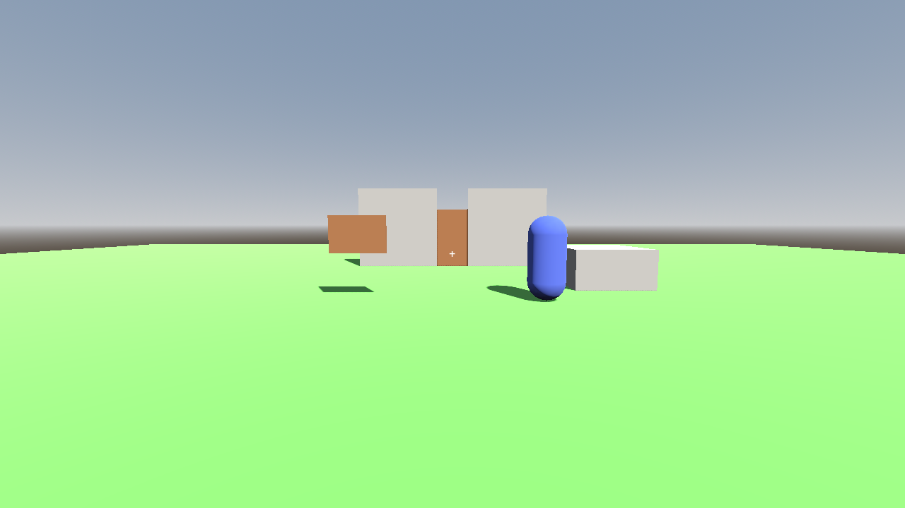
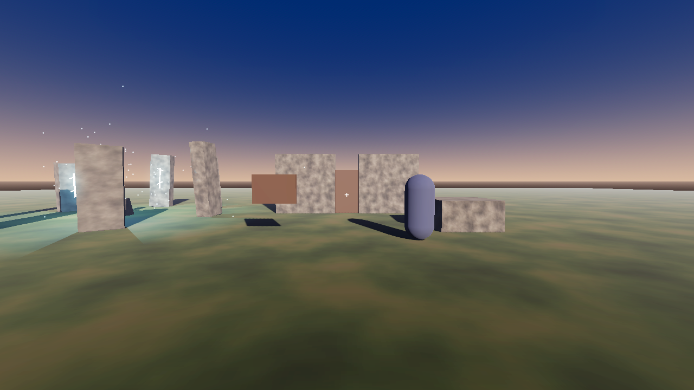
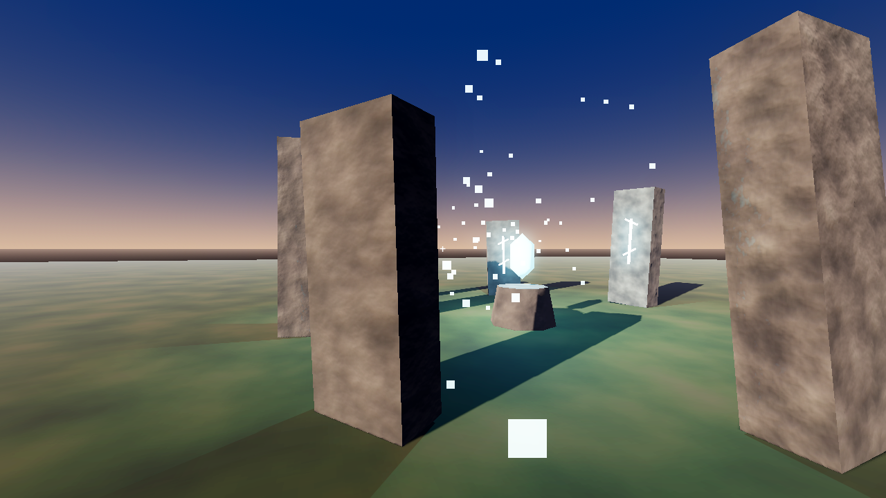

# Art Direction & Assets (first pass)

**Target look:** Avowed / Skyrim. Grounded, close-to-real materials, with magic that is
obviously *not* real: glowing runes, cold light, drifting motes, haze.

The plan to get there on a solo budget:
1. **Real-looking base:** photo-scanned CC0 textures and models (Poly Haven, ambientCG).
2. **The mood comes from lighting, not assets:** low golden-hour sun, haze, volumetric fog,
   film-style tone mapping, slightly desaturated colour grade. This is done (see below).
3. **The mystical layer is built in-engine:** emissive materials, coloured lights,
   particles. The stone circle is the first example.

## What's in the project now (no downloads)

Before → after. These preview screenshots come from the **Compatibility** renderer, so they
have **no volumetric fog or SSAO**. Forward+ in your editor will look hazier and softer.

| File | What |
|---|---|
| `levels/atmosphere.tres` | Shared WorldEnvironment: sky, ACES tone mapping, SSAO, glow, distance fog, volumetric fog, colour grade. Reuse it in every outdoor level. |
| `props/stone_circle.tscn` | 7 standing stones with glowing runes, altar, floating crystal (E to touch), drifting light motes |
| `props/floating_crystal.gd` | Crystal hover/spin, flares on touch, sets flag `touched_crystal` |
| Noise materials in the level | Godot-generated stone and grass variation. **Placeholders** until real textures arrive. |
| `assets/models`, `textures`, `hdri`, `audio` | Empty folders for downloads |
| `CREDITS.md` (in `godot/`) | License log. Fill it in as you download. |

**Renderer caveat:** volumetric fog and SSAO only work in the **Forward+** renderer (what this
project uses on desktop). The **Mobile** and **Compatibility** renderers skip them. If you later
target Android/Google Play with the Mobile renderer, the scene will look flatter and you'll
want to make up for it with regular fog and baked lighting.

## Terrain3D (installed in your local project)

- **Updating from this repo:** `project.godot` here lists Terrain3D under
  **[editor_plugins]**, so copying `godot/` over your project keeps the plugin enabled. The
  addon itself lives in your `addons/terrain_3d/` folder, which isn't in the repo, so copying
  never touches it. Without the addon, the editor shows a one-time "failed to load" warning and
  carries on.
- **The test level doesn't use Terrain3D yet.** It needs testing with the real addon,
  which can't be downloaded in the cloud session that builds these systems.
- **When you add a Terrain3D node, check these three things:**
  1. **Collision layer 1 "world"** (Terrain3D → Collision → Layer). Otherwise the player and
     wolves fall through it (the same lesson as the very first bug).
  2. **Navigation:** wolves need the terrain in their walkable map. Terrain3D has its own
     navigation-baking support; see its docs ("Navigation").
     `levels/nav_region.gd` only reads StaticBody3D collision, which Terrain3D isn't.
  3. **Delete or lower the green box ground**, so the two don't fight.

## Download list (by category)

Poly Haven (polyhaven.com) and ambientCG (ambientcg.com) are both CC0. Pick **1K or 2K**
resolution. 4K/8K files bloat the repo and won't look different at this stage.

**Textures** (download the JPG/PNG maps: Diffuse/Color, Normal **GL**, Roughness, AO):
- [ ] Forest floor / grass with dirt (main ground)
- [ ] Mossy rock (standing stones, boulders)
- [ ] Rock cliff / rough stone (walls)
- [ ] Old wood planks (door, sign)
- [ ] Tree bark

Godot uses the **OpenGL (GL)** normal-map convention. If a site offers "DX" and "GL", take GL.

**Models** (download as **glTF**):
- [ ] 3–5 rocks/boulders of different sizes
- [ ] A dead tree trunk or stump, a fallen log
- [ ] Ferns / grass clumps / bushes
- [ ] Trees: Poly Haven has a few, but **trees are the hardest thing to get free and
  realistic**. Expect to either buy a tree pack or use a tree-generator later.

**Sky** (Poly Haven HDRIs, **2K .hdr**):
- [ ] One golden-hour or partly-cloudy outdoor HDRI. Replaces the procedural sky and gives far
  more realistic lighting.

**Characters:** the hardest category for this style.
- **Established:** MakeHuman exports are CC0 and give realistic humans; ears and proportions can be
  adjusted toward elves in Blender. Mixamo provides free rigging and animations.
- **Not verified, check each license:** realistic orc models are rare for free. Paid
  marketplaces (Fab, Unity Asset Store, ArtStation) have them, but some licenses restrict which
  engine you can use. Read before buying. (Synty and other low-poly packs don't fit this target
  style.)

## Using downloads in Godot

**Texture → material** (e.g. new ground):
1. Copy the maps into `assets/textures/<name>/`.
2. Click `Ground/MeshInstance3D` → Inspector → Mesh → Material → **New StandardMaterial3D**
   (or edit the existing one).
3. **Albedo → Texture**: drag the *diffuse/color* map. **Normal Map**: tick Enabled, drag the
   *nor_gl* map. **Roughness → Texture**: drag the *rough* map. **Ambient Occlusion**: tick, drag *ao*.
4. **UV1 → Triplanar: On**, **World Triplanar: On**, **Scale** e.g. `0.25, 0.25, 0.25`.
   This tiles the texture across the ground with no UV work.

**Model with collision**:
1. Copy the `.gltf`/`.glb` and its textures into `assets/models/<name>/`.
2. Double-click it in FileSystem → **Advanced Import Settings** → click the mesh in the tree →
   tick **Physics** → Body Type **Static** → Shape Type: **Simple Convex** for rocks,
   **Trimesh** for big cliffs/buildings → **Reimport**.
3. Drag the file into the level. Turn on **Debug → Visible Collision Shapes** and walk into it
   to check.

**HDRI sky**:
1. Copy the `.hdr` into `assets/hdri/`.
2. Open `levels/atmosphere.tres` → **Sky → Sky Material** → **New PanoramaSkyMaterial** →
   **Panorama**: drag the `.hdr`.
3. Rotate the **Sun** DirectionalLight3D so its shadows match the sun in the image.

Then add a row to `CREDITS.md` for each one.
