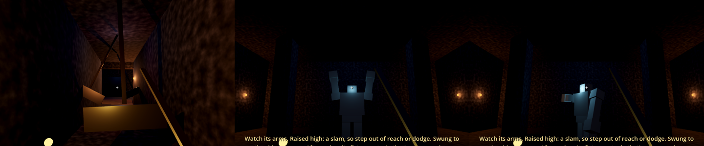

# Dungeon toolkit: traps, puzzles and a boss

Building blocks for dungeons, and a greybox **test dungeon** that uses all of them: walk
into the **old barrow** about 35 m south-west of spawn (the wooden door in a stone mound), or open
`levels/test_dungeon.tscn` and press F6.

Everything here is lore-free placeholder: the riddle text, names and loot are there to be
replaced. The parts are boxes and simple shapes, posed in code, so they work without bought
assets and can be reskinned later (swap the meshes, keep the nodes).

## Traps (`props/traps/`)

| Part | What it does |
|---|---|
| **PressurePlate** (`pressure_plate.gd`) | Stepping on it (player or enemy) calls `activate()` on everything in **Targets**. Sits 6 cm proud in paler stone, so it can be spotted and stepped around. **E** tries to disarm it: 55% + 5% per Agility point above base; a failure sets it off. **Rearm Time** 0 = fires once. Remembers being disarmed. |
| **DartTrap** (`dart_trap.gd`) | Fires a burst of darts along its −Z when activated. Darts go through the normal hit rules: block, ward, dodge and parry all work. An unblocked hit may poison (35%). Darts hit enemies too. |
| **SwingingBlade** (`swinging_blade.gd`) | A pendulum swinging across a corridor. Too heavy to block: 25 damage, a stagger and a shove. Only dangerous while moving fast, so time your run; a dodge's invulnerability gets you through. **Phase** puts blades in a row out of step. Can start still and be activated by a plate. |

A plate's **Trigger** is an Area3D child (mask: player + enemies); give it a shape a little
taller than the plate. A blade's **Hitbox** is an Area3D around the blade; it swings with the
node.

## Puzzles (`props/puzzle/`)

| Part | What it does |
|---|---|
| **Lever** (`lever.gd`) | **E** flips it; emits `toggled(on)`. **One Way** levers stay pulled. Remembers its position. |
| **PuzzleGate** (`puzzle_gate.gd`) | A portcullis that slides up when every lever in **Levers** matches **Combination** (on/off), or when `activate()`/`open()` is called (a plate, an arena). **Close When Unsolved** makes it shut again if a lever moves back. **E** on a closed gate shows **Locked Message** — a place for a clue. Remembers being open. |
| **BossArena** (`boss_arena.gd`) | An Area3D over the arena floor. When the player walks in: shuts **Gates**, wakes the **Boss**, shows its health bar. When the boss dies the gates open. If the boss was beaten before, the gates are simply open. If the player is beaten (Hardcore defeat), the boss goes back to its statue and the gates to how they were. |

| **SecretWall** (`secret_wall.gd`) | A piece of wall with a prompt (**Prompt Text**, "Examine the scrape marks"). **E** shows **Open Message** and sinks it into the floor; remembered with **Opened Flag**. Put the clue next to it (scrape marks, a draught). |

In the test dungeon the riddle on the east wall ("the outer two wake; the one between them
sleeps") means: pull levers 1 and 3, leave 2.

## The Stone Guardian (`enemies/stone_guardian.tscn`)

A boss that stands as a statue (hits just clang off) until its arena wakes it. 400 Health.

| Move | Telegraph | Answer |
|---|---|---|
| **Slam** | Both arms rise over its head for ~1 s, eyes flare | Step out of the 2.4 m circle in front of it, or dodge. Blocking works but costs a lot of Stamina (30 damage, heavy poise). |
| **Sweep** | One arm swings out to the side, body twists | Back off past 3.6 m or dodge. |
| **Punish window** | After a slam its fists are stuck for 1.4 s | Hits do 1.5× damage. |
| **Phase 2** (half Health) | Eyes turn red | Faster windups and movement; every slam sends a **shockwave** along the floor out to 10 m. Jump over it (or dodge). |

Heavy and hard to stagger: its poise (150) breaks only after many hits, then it kneels for
3 s. Weapons and spells hurt it the same. It crumbles when killed, drops a **Guardian Heart**
(worth 150), and stays dead (WorldState).

## The First (`enemies/the_first.gd`, main quest 5)

The demo's final boss, at the Hollow Oak in the Thornwood (north-east of the outlaw camp in
the test level). It's the Stone Guardian's body and moves (slam, sweep, phase 2) with
`the_first.gd` swapped in:
- pale, swollen (the model is scaled 1.25×; the collision shape isn't) and glowing, pulsing
  faster as it weakens;
- it **leaks**: every 7 s (4 s in phase 2) a ring of stolen light rolls out from it along the
  ground (10 damage): jump it;
- it comes apart into light when killed (no heart), sets `first_slain`, and a stream of light
  (a DrainLine) rises from it towards the north.

The **RitualSite** (`props/ritual_site.gd`) runs the scene around it. By day the clearing is
empty: the boss, the three hooded cultists and the ritual light are hidden, frozen and
untouchable, and the first visit says to come back after dark. At night, the first time you
come within 20 m, the ritual is under way: everything appears, the cultists wake, and the
BossArena around the oak arms itself (stepping in wakes The First). The **RitualAltar**
(`props/ritual_altar.gd`) offers the cult's sealed letter once it's dead.

To make another boss: copy `stone_guardian.gd`'s structure. The arena only needs the boss to
have `wake(player)`, `is_defeated()`, `display_name`, `stats` and a `died` signal.

## The hidden chamber (main quest 4, "The Barrow")

West of the vault, behind a `SecretWall` with scrape marks running up to it, is the hooded
folk's workshop:
- empty wisp cages and **the last caged wisp** (`props/caged_wisp.gd`). Its dialogue
  (`dialogue/caged_wisp.json`) lets you **free it**, after which it follows you everywhere as a
  small light (`props/wisp_companion.gd`), or **take its essence**: +25 max Magicka, and −15
  with the Thornwood Free;
- three jars of stolen light on a worktable (readable), and **the cultist's notes and map**
  (a pickup), which point to the Hollow Oak (quest 5);
- **two hooded cultists** (`enemies/cultist.gd`: a bandit in robes that doesn't take prisoners).
  They stand still until the wall opens (`wait_for_flag`), so they don't press against the
  wall at a player on the other side.

## Building your own dungeon

1. New scene from `levels/test_dungeon.tscn` (Scene → New Inherited Scene), or copy the
   cellar's setup: WorldEnvironment, Player, an Ambience node with **Indoor** on, and lights.
2. Floors: StaticBody3D in the group `surface_stone` (for footsteps).
3. Way in and out: a `location_door.gd` door on each side, each pointing at a Marker3D in the
   other scene (see FOUNDATIONS.md, interiors).
4. Drop in plates, darts, blades, levers and gates; wire them with the NodePath lists in the
   Inspector.
5. Light it brighter than feels right: dark rooms make the boss's telegraphs hard to read.

The greybox layout was generated by a script, so its node names are plain (`HallFloor`,
`WallLeverRoomArenaW`...). Rename freely; only the NodePaths in plates, gates and the arena
need to keep pointing at the right nodes.

## Known limits

- The guardian walks straight at you (no pathfinding): pillars can snag it briefly.
- Darts and the shockwave don't care about line of sight beyond walls in their path.
- No trap-finding skill or Security/Lockpicking yet: disarming uses Agility only.
- Only one boss, and no boss music.
- Looks dark in the Compatibility renderer screenshots; not checked in Forward+.
