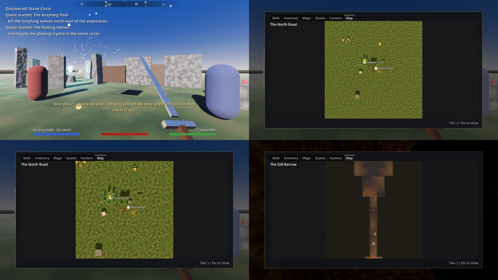

# Compass, quest markers and the map



## Compass

A strip at the top of the screen shows the way you're facing (N, NE, E...) across 180°.
On it:
- **Gold markers:** where your active quests want you to go next. Line one up with the
  middle of the strip to see how far it is.
- **Pale icons:** places you've discovered, up to 300 m away. A house is a settlement, a tent
  a camp, a doorway a dungeon, a diamond a landmark.
- **Dim icons:** places you haven't found yet, when you're within 60 m.

## Map (M, or the Map tab in the Tab menu)

A top-down picture of the level, taken when you open it, with:
- the places you've discovered, with their names
- gold pins for quest targets
- you, as a red arrow pointing the way you face

Mouse wheel (or RT / LT on a gamepad; left/right click with a mouse) zooms in and out.
Zoomed in, it centres on you. Interiors have their own maps, drawn from just under the
ceiling. **M** can be rebound in Settings → Controls.

## Adding places

Add a **MapMarker** node (`props/map_marker.gd`) where the place is:
- **Location Id:** a short unique id (`old_barrow`). Discovery is saved as the story flag
  `discovered_<id>`, so dialogue and quests can check it too.
- **Display Name:** shown on the map and in "Discovered: ...".
- **Kind:** Landmark, Settlement, Camp or Dungeon (the icon).
- **Discover Radius:** how close you have to get (default 18 m).
- **Starts Discovered:** for where the game begins.

The test level has five: Waystation, Stone Circle, Greyfang Hollow, Bandit Camp, The Old
Barrow. The names are placeholders.

## Quest markers

In `quests/quests.json`, give an objective a **marker**: the name of the node it's about, or
a list of names.

```json
{ "text": "Return to Maren.", "done_when": {...}, "marker": "Maren" }
{ "text": "Find three rune shards...", "done_when": {...}, "marker": ["RuneShard1", "RuneShard2", "RuneShard3"] }
```

Only the **next** unfinished objective of each active quest is marked. Names are looked up in
the current level, so a shard you've picked up (removed) drops off, and a target in another
level isn't shown.

## A map for a new level

Add a **LevelMap** node (`levels/level_map.gd`):
- **Map Name:** the title shown on the map.
- **Area:** the part of the world to show, as x, z, width, depth (north is −z).
- **Camera Height:** above the tallest thing outdoors; just under the ceiling indoors.

Without one, the map tab says there's no map of this place.

## Known limits

- **Other levels:** a quest target in another level isn't pointed to; it doesn't lead you to
  the door you'd need.
- **Detail:** the map is the level seen from above in its real colours, not a drawn map. With
  bought art it will look like the world. Greybox boxes look like boxes.
- **Fast travel:** none yet. It's planned with Hardcore turning it off; see the roadmap.
- **Tracking:** you can't choose which quest to track; every active quest is marked.
