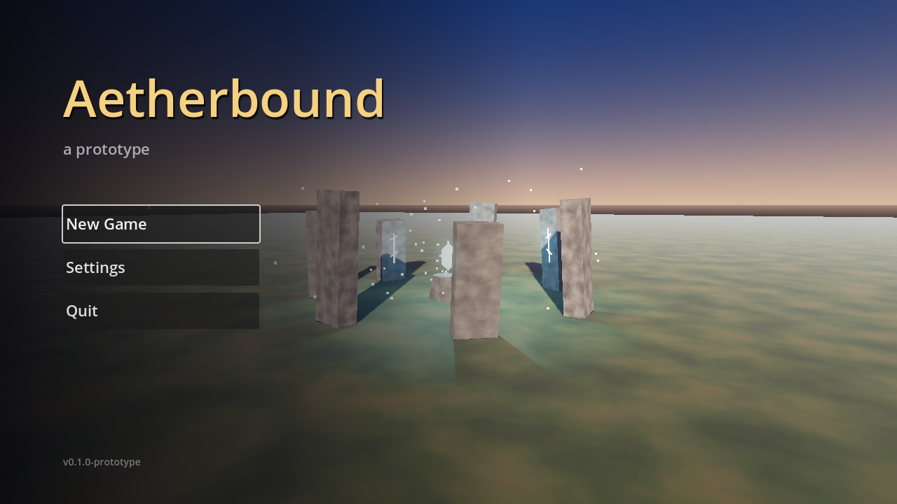
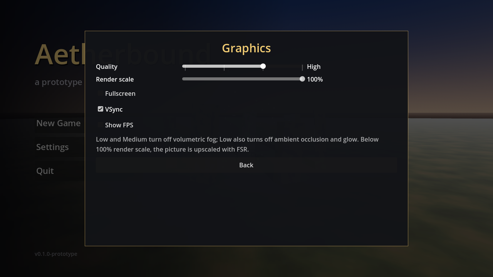

# Health, Stamina, Magicka & Saving

## Stats

The bars at the bottom of the screen: **Magicka** (blue, left), **Health** (red, centre),
**Stamina** (green, right). Maximums come from your race (`races/*.tres`).

| | What uses it now | Regen |
|---|---|---|
| Health | Fall damage. Landing faster than 9 m/s (about a 4 m drop) hurts; ~25 m kills | 0.5/s |
| Stamina | Sprinting drains 12/s. At 0 you're **exhausted** and can't sprint until it's back to 20 | 15/s, after a 1 s pause |
| Magicka | Spells (see MAGIC.md) | 5/s, after a 1 s pause |

All numbers are `@export`s. Click **Player → Stats** in `player.tscn` for regen, or **Player**
itself for sprint cost and fall damage.

**Death:** "You have died." Then, after 2.5 s, your **last save loads** (like Skyrim). With no
save, you respawn at the level start.

`systems/stats.gd` (`class_name Stats`) is a reusable node. Enemies get one too, so
`take_damage()` works the same on anything.

```gdscript
$Stats.take_damage(20)
if $Stats.try_use_stamina(15): ...   # false if not enough
$Stats.died.connect(_on_died)
```

## Saving

| Key / button | |
|---|---|
| **F5** | Quicksave (its own slot) |
| **F9** | Load the **most recent** save, whichever slot it's in |
| **Esc → Save Game** | 5 manual slots. Clicking a used slot asks "click again to overwrite" |
| **Esc → Load Game** | Every save, newest first, with **Delete** (asks "Sure?") |
| **Title: Continue** | Loads the most recent save |
| **Title: Load Game** | Same list as Esc → Load Game |
| **Title: create a character → Begin journey** | Starts fresh (story, skills, items, spells, reputation, play time). Saves stay |

Each slot shows name, race and background, character level, location, play time and when it was saved, e.g.
"Slot 2 - Grukka (Orc Soldier), level 3 - Test Level - 0h 42m played - 2026-10-23 16:31". Play time only
counts while you're in a level and not paused.

You can't save while talking or dead. Dying loads your most recent save (or respawns you if
there's none).

**Saved:** level, race, story flags, skills, inventory, spells, reputation, play time,
player position and look direction, current Health/Stamina/Magicka. Quest progress is
worked out from flags and items.
**Not saved:** anything not driven by a flag. Open doors reset on load, for example.

Saves are readable JSON in `user://saves/` (`quicksave.json`, `slot_1.json` …). Open that
folder with **Project → Open User Data Folder** in the editor. A save from before slots
existed (`user://savegame.json`) is moved to the quicksave automatically. Older save
versions still load.

## Title screen, pause menu & settings

The game opens on the **title screen** (`ui/title_screen.tscn`, the project's main scene): the
stone circle at dusk with the camera slowly circling it, and **Continue** (the most recent save;
only shown if there is one), **New Game**, **Load Game**, **Settings**, **Report a Bug**, **Quit**.
The name on it is `GAME_TITLE` in `ui/title_screen.gd`, a placeholder until the title is
decided. The version under it is **Project Settings → Application → Config → Version**.



**Esc** pauses: Resume, Save Game, Load Game, Settings, Report a Bug, Quit to Title, Quit Game.
While talking or in the Tab menu, Esc closes those first. In a sub-page, Esc (or B) goes back
one page.

**Settings** apply immediately and are kept in `user://settings.cfg`, separate from saves, so
they apply to every character:

| Setting | Range |
|---|---|
| Mouse sensitivity | 0.2x - 3.0x |
| Invert mouse Y | on/off |
| Field of view | 60 - 100 |
| Volume | 0 - 100% |
| Tutorial hints | on/off |
| **Graphics...** | see below |
| **Controls...** | rebinding (CONTROLS.md) |

### Graphics

| Setting | What it does |
|---|---|
| Quality | Low / Medium / High / Ultra (below). High is the look as designed, plus 2x MSAA (the project had no anti-aliasing before) |
| Render scale | 50 - 100%. Below 100% the 3D picture renders smaller and is upscaled with AMD FSR 1 (the menus stay sharp) |
| Fullscreen, VSync | on/off |
| Show FPS | frame rate and frame time, top right, in every scene |



| | Low | Medium | High | Ultra |
|---|---|---|---|---|
| Volumetric fog | off | off | on | on, finer |
| Ambient occlusion (SSAO) | off | low | medium | high, full size |
| Glow | off | on | on | on |
| Shadow map | 1024 | 2048 | 4096 | 8192 |
| Shadow distance | 50% | 75% | 100% | 150% |
| Soft shadows | hard | very low | low | high |
| Anti-aliasing | FXAA | FXAA | MSAA 2x | MSAA 4x |

The presets only switch effects **off** relative to how a scene was built: a level without
volumetric fog doesn't gain it on Ultra. Shadow distance multiplies each sun's own **Directional
Shadow → Max Distance**. To change a preset, edit `QUALITY` in `systems/settings.gd`. New
scenes need nothing: `Settings` applies the preset to every WorldEnvironment and
DirectionalLight3D as it enters the game.

**Not measured yet:** these are standard Godot settings with typical costs, but nobody has
profiled this game on real hardware. Check the FPS counter on your PC, and on a low-end
laptop if you can, before trusting the presets.

### Report a Bug

**Report a Bug** (pause menu and title screen) copies a block of diagnostics to the clipboard
and shows it: game and Godot version, OS, CPU, GPU and driver API, screen size, graphics
settings and FPS, the scene, the player's position, level, race, background and modes, the
in-game time, and the last 40 lines of the log (`user://logs/godot.log`). The player pastes
it wherever you collect reports. To add an **Open bug report page** button, set `REPORT_URL`
in `systems/bug_report.gd` (empty for now: there's no public tracker yet).

**F5 in the editor:** F5 is also the editor's "Run" shortcut, but while the game window has
focus, the game gets the key. If you use Godot 4.4+'s embedded game view and F5 restarts the
game instead of saving, click inside the game first, or turn embedding off (Game tab →
⋮ → uncheck "Embed Game on Next Play").
